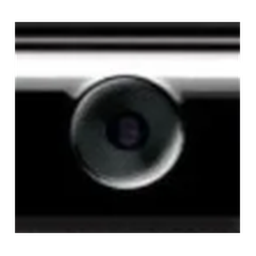
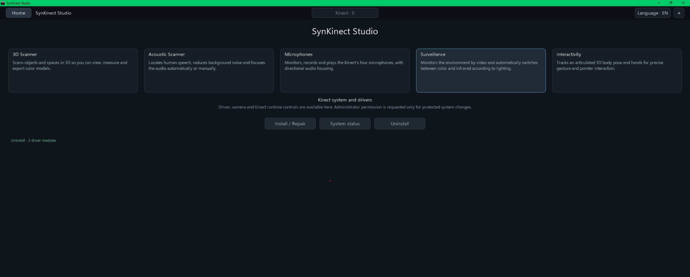
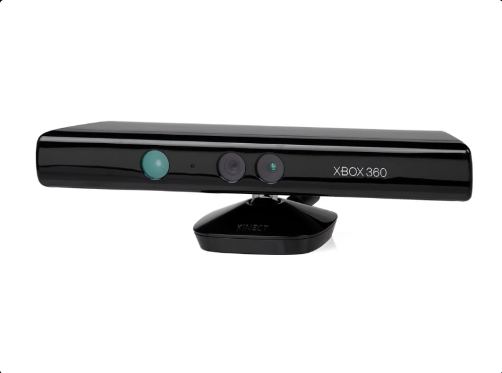
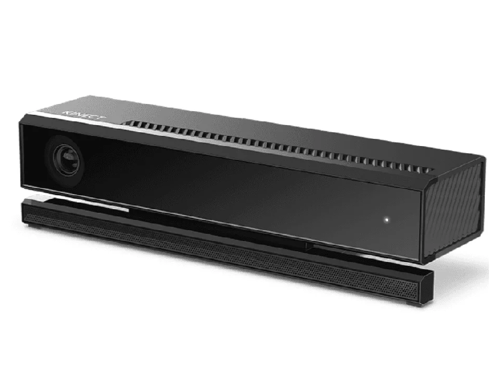
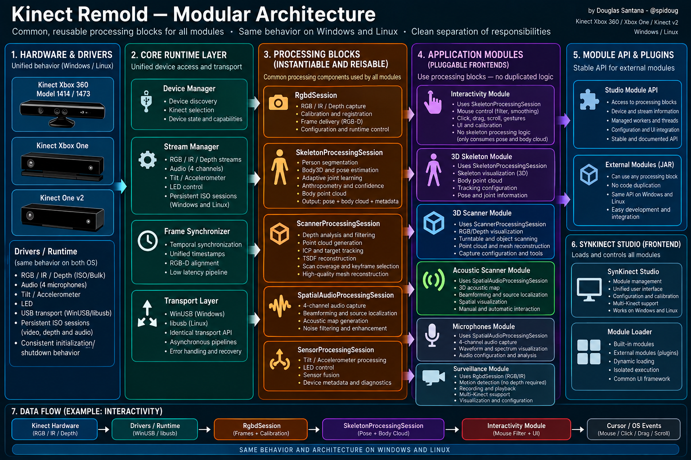
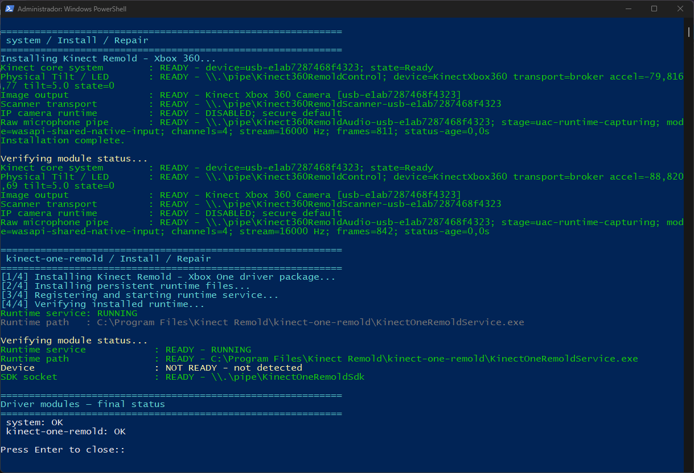
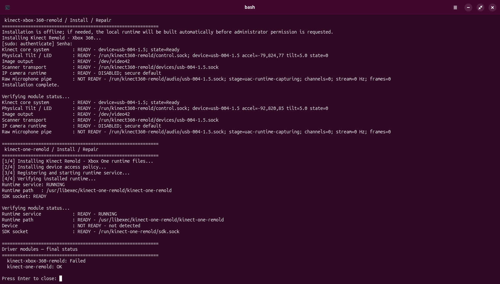
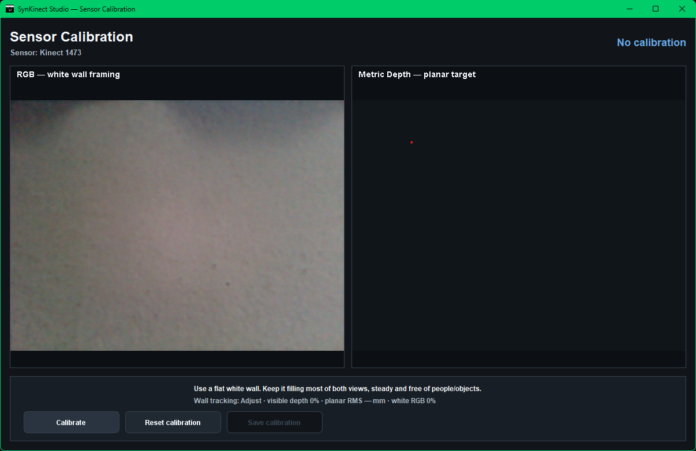

<div align="center">
  
</div>

# Kinect Remold

## Disconnect and reconnect timing

The Windows and Linux drivers use the same short-failure policy for physical Kinect loss. A missing or stalled device is treated as disconnected within a maximum target window of about 3 seconds. Normal/depth frame watchdogs fire before that window, high-quality RGB is capped at 3 seconds, USB/pipe I/O used by the device runtimes is capped at 3 seconds, and the Studio removes a vanished device after a 3-second grace period. Discovery/reconnect polling runs several times per second so unplug/replug state changes are reflected promptly without long UI stalls.

This 3-second policy applies to runtime device loss and stalled transport. Longer operation-specific waits that are not disconnect detection (for example installation, firmware preparation/download, recording policy, or physical actuator operations) keep their own bounded timing.

## A cross-generation runtime and Studio for Kinect sensors

**Models 1414 + 1473 + 1517 · Kinect v2 / Xbox One · RGB · Depth · IR · Audio · Tilt/LED where hardware supports them · Multi-Kinect**


<p align="center">
  
</p>

**by Douglas Santana · @spidoug**

Kinect Remold provides native runtimes and SynKinect Studio for first-generation Kinect models 1414, 1473 and Kinect for Windows 1517, plus Kinect v2 / Kinect for Xbox One, without storing downloaded SDKs, toolchains or generated binaries in the source tree. Windows and Linux follow the same capability-oriented runtime design—driver-module discovery, camera/audio services where implemented, per-device control and Studio integration—while each driver module advertises only the operating-system endpoints it actually provides. The native transport layer changes between WinUSB / Windows USB Audio / WASAPI / Media Foundation or local MJPEG on Windows, and libusb / ALSA (`snd-usb-audio`) / V4L2 on Linux.

For first-generation Xbox 360 Kinects, Windows 11 can expose a Media Foundation virtual camera per device; Windows 10 build 19041 or newer uses the loopback-only local MJPEG image backend instead. The Kinect One/v2 runtime currently publishes its imaging transport to the Remold SDK/Studio and does not advertise an operating-system virtual camera. Generation-specific support is isolated into driver modules. The Xbox 360 module provides tilt, LED and four-microphone-array integration; the Xbox One module provides its native imaging transport and calibration capabilities.

### Driver modules

Source drivers live under `drivers/modules/<module-id>/`. Each module owns native transports, installation, runtime services and its public discovery endpoint. Device rows include a stable `module-id` and `generation`, so SynKinect Studio can route multiple generations concurrently without assuming one transport implementation.

Current modules: **Kinect Remold — Xbox 360** (`kinect-xbox-360-remold`, generation `xbox-360`) and **Kinect Remold — Xbox One** (`kinect-one-remold`, generation `xbox-one`).

The names `kinect-xbox-360-remold` and `kinect-one-remold` are stable technical module IDs used in generated build paths and interfaces. They are not product titles. User-facing branding and common generated product folders use **Kinect Remold**.

<table>
<tr>
<td align="center"><br><strong>Kinect Remold — Xbox 360</strong></td>
<td align="center"><br><strong>Kinect Remold — Xbox One</strong></td>
</tr>
</table>

### Platform and module overview

| Capability | Kinect Remold — Xbox 360 | Kinect Remold — Xbox One |
|---|---|---|
| Hardware | 1414, 1473, Kinect for Windows 1517 | Kinect v2 / Kinect for Xbox One |
| Windows transport | WinUSB + Windows USB Audio/WASAPI | WinUSB |
| Linux transport | libusb + ALSA (`snd-usb-audio`) | libusb |
| RGB / depth / IR | Yes | Yes |
| Native calibration metadata | Yes | Yes |
| Four-microphone Remold endpoint | Yes, 4ch @ 16 kHz | Not currently advertised |
| Tilt / LED / accelerometer controls | Yes where hardware provides them | Not applicable to v2 hardware |
| 3D Scanner / Interactivity / Motion Capture / Surveillance | Yes | Yes for implemented imaging capabilities |
| Microphones / Acoustic Scanner | Yes | Requires a future v2 audio bridge |
| Multi-Kinect routing | Stable per-device ID | Stable per-device ID |

Both modules are available on Windows and Linux through one capability-driven Studio. A module never receives controls for hardware capabilities it does not advertise.

### SynKinect Studio features

- **3D Scanner** — Turntable and moving-Kinect fusion with TSDF reconstruction, Refine HQ and STL/OBJ/PLY export.
- **SynSkeleton body tracking** — `SynSkeleton.onnx` is the single pose source for body, hands and fingers. Metric Depth feeds the neural model and calibrates its XYZ output; all Studio modules consume the same neural skeleton.
- **Interactivity** — hand-driven desktop pointer with per-hand interaction zones, push-to-click, two-hand gestures and a two-hand **air keyboard**.
- **Motion Capture** — real-time body streaming as VMC (OSC/UDP), plain OSC, JSON over UDP and WebSocket to VSeeFace, Unity, Blender and Unreal, plus BVH recording.
- **Sensor Calibration** — per-device depth calibration from flat-wall captures with an optional tape reference, measured by a ground-truth **calibration benchmark**.
- **Acoustic Scanner / Microphones** — four-channel localization, beamforming, noise suppression and raw recording.
- **Surveillance** — multi-Kinect RGB/IR motion recording.
- **Module SDK** — external JAR modules with host-owned UI blocks, depth calibration and body tracking.

Headless regression tests for Scanner, skeleton, calibration, Interactivity and Motion capture are maintained in `tests/`; see [Testing and benchmarks](docs/README.md#testing-and-benchmarks).

> The Microsoft UAC firmware is not committed to the repository. The build system obtains and verifies the required image from the official Kinect Runtime package, or accepts the exact validated image for an offline build.

## Architecture

<p align="center"></p>

Every connected Kinect is represented by one stable device identity. That identity binds the transports and application endpoints that the concrete driver actually publishes for the same physical sensor; unsupported capabilities such as v1 motor control, audio or an operating-system camera are not fabricated for another generation.

For each connected Kinect, one stable device identity routes every capability that its driver module actually publishes. Camera/scanner operations use that identity, and SynKinect Studio enables controls only when the selected device advertises the required endpoint. The Xbox 360 module additionally publishes its four-channel audio/audio-control endpoints plus model-specific motor, LED and accelerometer controls; its LED API exposes `Off`, `Green`, `Red` and `BlinkGreen` on 1414, 1473 and 1517. The Xbox One module publishes its implemented imaging capabilities without inventing Xbox 360-only controls or an audio endpoint that is not yet implemented.

Windows uses WinUSB for Remold-owned USB transports, the Windows USB Audio stack for the Kinect UAC runtime and WASAPI for four-channel capture. On Windows 11 the RGB system output is a Media Foundation virtual camera. On Windows 10 build 19041 or newer the installer selects the local MJPEG backend automatically and binds it to `127.0.0.1` by default.

Linux uses libusb for Kinect camera/control transport and the kernel USB Audio driver (`snd-usb-audio`) through ALSA for all three first-generation models. The first-generation Xbox 360 module publishes one v4l2loopback system-camera endpoint per connected Kinect; the Kinect One/v2 module currently exposes imaging through its Remold SDK/Studio transport only. All first-generation audio paths are normalized to the same four-channel Remold ABI.

## Smart virtual camera and automatic tilt

Automatic Tilt is scoped to each Kinect independently.

For first-generation Kinects on Windows 11 and Linux, the virtual camera for a Kinect tracks whether that specific virtual camera is being consumed. While active, its face tracker evaluates that Kinect's RGB stream and adjusts only that Kinect's motor through the per-device control route. Windows 10 uses the local MJPEG image-output backend; manual Tilt and all Studio tracking remain available, but the Media Foundation virtual-camera auto-framing layer is not instantiated on that platform. Accelerometer feedback, command rate limits, dead zones and motor settling limits are applied independently per sensor.

When a virtual camera is not being consumed, its face-tracking Tilt loop does not move the corresponding Kinect.

For first-generation Kinects on Windows 11 and Linux, the virtual camera carries the Kinect RGB stream and follows the RGB HQ setting of its Kinect: 1280x1024 while RGB HQ is on, 640x480 otherwise. Digital pan, zoom and vertical framing follow the same face target as the motor. Windows 10 publishes RGB through the local MJPEG backend and does not instantiate the virtual-camera framing layer.

Linux and Windows run the same Smart Tilt controller and motion interface: the camera service is the only component that polls motor status (1414, 1473 and 1517 every 25 ms, only while a frame consumer is active) and every frame carries its accelerometer/tilt sample. See [`docs/MOTION.md`](docs/MOTION.md).

## IP camera

The HTTP/MJPEG runtime is secure-by-default. On Windows 11 it is an optional IP-camera feature and is disabled after a fresh install. On Windows 10 it is also the automatic local image-output backend, enabled only on `127.0.0.1`; this local loopback mode does not create a firewall rule or expose the camera to the LAN. LAN access remains an explicit administrator action. Credentials are randomly generated and hidden from normal status output. On normal enable, the stream is pinned to one stable Kinect `deviceId`, so a disconnected sensor is not silently replaced by another camera. LAN mode is limited to private/link-local peers; Windows additionally limits its firewall rule to the Private profile and LocalSubnet. Repeated failed logins are rate-limited, request sizes/routes/methods are constrained, and browser-facing responses carry restrictive security headers.

The built-in transport is authenticated HTTP, not TLS. Do not expose it directly to the public internet; use a VPN or TLS reverse proxy for access outside a trusted private network. Linux runs the IP service as a dedicated unprivileged account. Local product IPC is available immediately to the desktop session; physical USB nodes remain protected by udev/logind access control.

## Studio preferences

SynKinect Studio keeps packaged configuration and user choices separate. Locale catalogs and application defaults remain under `applications/processing/SynKinectStudio/data/`; the last language selected in the Studio and small UI preferences are stored in the operating-system user's Java preference store and are restored automatically on the next launch.

## Build output

A full build creates one root output tree:

```text
binaries/
├── windows/
│   ├── applications/
│   │   └── SynKinectStudio/
│   ├── drivers/
│   │   ├── kinect-xbox-360-remold/
│   │   └── kinect-one-remold/
│   └── sdk/
│       └── kinect-xbox-360-remold/
└── linux/
    ├── applications/
    │   └── SynKinectStudio/
    ├── drivers/
    │   ├── kinect-xbox-360-remold/
    │   └── kinect-one-remold/
    └── sdk/
        └── kinect-xbox-360-remold/
```

No generated binary is written to `applications/` or `drivers/`.

Product-owned generated and installed folders use the common **Kinect Remold** root. Machine-dependent paths are discovered at runtime or supplied through `REMOLD_*` overrides; see `config/README.md`. On Windows, build cache/work data lives below `%LOCALAPPDATA%\Kinect Remold\`, shared runtime state below `%ProgramData%\Kinect Remold\`, and persistent generation runtimes below `C:\Program Files\Kinect Remold\<module-id>\`. Linux uses XDG `kinect-remold` user storage and conventional technical module locations such as `/usr/libexec/kinect-one-remold`. The module IDs remain lowercase/hyphenated because they are stable machine-facing identifiers, not branding.

## Windows build

Double-click or run:

```bat
Kinect-Remold.cmd
```

If any required binary is missing, the launcher builds the complete Windows runtime and Studio. When all artifacts are ready it starts the native `SynKinectStudio.exe` application and the build Command Prompt exits. The root launcher resolves the project from its own location rather than the current working directory, tolerates spaces and wrapper directories created by repeated ZIP/7z extraction, and keeps the Windows command entry points ASCII/CRLF-safe for `cmd.exe`.

The build downloads verified build dependencies into:

```text
%LOCALAPPDATA%\Kinect Remold\Cache\windows
```

and keeps temporary work outside the repository under:

```text
%LOCALAPPDATA%\Kinect Remold\Work\windows
```

The generated runtime control entry point is:

```text
binaries\windows\drivers\kinect-xbox-360-remold\KINECT.cmd
```

SynKinect Studio is generated under:

```text
binaries\windows\applications\SynKinectStudio\
```

## Linux build

### Linux camera startup parity

The Xbox 360 Linux camera bridge keeps the libusb isochronous queues for endpoints `0x81` (video/IR) and `0x82` (depth) alive for the physical USB session after their first use. Closing one Studio module stops only the firmware stream engine; opening another module reuses the prepared transport. This mirrors the Windows CameraBridge lifetime model and avoids repeated endpoint teardown/recreation. Kinect One/v2 keeps the same per-client session model as its Windows counterpart, but the Linux subscription hot path skips the redundant discovery probe immediately before opening the real stream.

### Linux audio runtime parity

The Xbox 360 Linux AudioBridge follows the same resident per-device lifetime used by Windows. One native capture session is owned by each physical Kinect and feeds a multi-client fanout bus continuously; opening or closing Microphones, Acoustic Scanner or another Studio consumer does not reopen the ALSA capture. All three models (1414/1473 after the UAC firmware upload, 1517 natively) are captured through `snd-usb-audio` / ALSA; the bridge retains the last valid topology binding through transient udev/sysfs discovery gaps and reconnects only after a real transport error or endpoint re-enumeration. The native 48 kHz stream is decimated to 16 kHz through an anti-alias FIR, as on Windows. The same four-channel stream is republished through the `KinectRemold` ALSA loopback capture card so Linux applications retain a normal operating-system microphone endpoint while the Studio bus stays active. During a firmware/UAC transition the Linux maintenance UI may show `PENDING`, but a connected first-generation Kinect is not considered successfully verified until four-channel PCM and the Linux system-audio publication are both flowing.

Run or launch `Kinect-Remold.sh`. If required binaries are missing it builds the complete Linux runtime and Studio; otherwise it opens Studio directly. The launcher resolves symlinks and its own location, tolerates spaces and wrapper directories created by repeated archive extraction, and repairs executable bits on project shell scripts when it is able to start. Permission handling is generic and contains no fixed Linux username or group: if the generated `binaries/` tree is read-only, the launcher first attempts a normal owner-mode repair with `u+rwX`; if the operating system denies that change, it stops and prints UID/GID-based repair commands for whichever account is actually invoking the build. Ownership is never changed silently with elevated privileges. Distributed Linux archives preserve writable directory modes plus executable mode for the root launcher and build scripts. From a graphical desktop, a terminal is used only while a build is actually required. Missing compilation dependencies are detected before compilation and can be installed through the native `apt`, `dnf` or `pacman` package manager after the normal administrator prompt. The build preflight checks only tools and libraries actually required to compile/package the runtime; systemd/udev, account-management and kmod activation tools are validated later by the installation stage. If a build requirement is still unavailable after package setup, the preflight prints the exact missing command, pkg-config module or running-kernel header instead of a generic dependency failure. If compilation fails, the build terminal remains open and reports the failing stage and log path; after a successful build, the launcher verifies that SynKinect Studio actually starts before closing the build terminal.

The Xbox 360 Windows installation procedure follows the complete driver transaction implemented in the project’s canonical GitHub installer (`Spidoug/Kinect-Remold`). The control panel captures the verbose installer stream and presents only the operation result and final runtime status; no PnP, audio-firmware, camera, service, identity, trust, or verification stage is skipped. Linux maintenance follows the same quiet-console rule while retaining its complete native installation sequence.

The Linux launcher builds the runtime when required, and `INSTALL.sh` installs only the generated bundle. Hardware routing is model-specific: model 1414 uses the dedicated `045E:02B0` motor function; model 1473 leaves `045E:02C2 REV_0001` as the parent hub and uses runtime `02BB/02C3 MI_00`; model 1517 uses its dedicated `045E:02C2 REV_0100` control function and factory `045E:02BE` USB-audio runtime.


<table>
<tr>
<td align="center"><br><strong>Windows</strong></td>
<td align="center"><br><strong>Linux</strong></td>
</tr>
</table>

Windows and Linux intentionally present the same maintenance vocabulary and final health model. The native installation transactions differ, but both end by validating the Studio-facing device capabilities rather than treating an installed service as proof of hardware readiness. See the [unified device contract](docs/UNIFIED-DEVICE-CONTRACT.md).

The Linux build is also the provisioning boundary: it prepares the verified UAC firmware and compiles the pinned `v4l2loopback` module for the running kernel. `Install / Reinstall` and `binaries/linux/drivers/kinect-xbox-360-remold/INSTALL.sh` perform no download, package-manager operation or compilation; they install and verify only the already-built bundle.

```bash
./Kinect-Remold.sh
```

Temporary build work is kept outside the repository under the XDG cache location, or under `REMOLD_WORK_ROOT` when explicitly configured.

The generated runtime control entry point is:

```text
binaries/linux/drivers/kinect-xbox-360-remold/KINECT.sh
```

SynKinect Studio is generated under:

```text
binaries/linux/applications/SynKinectStudio/
```

## Firmware

Windows obtains and verifies the Microsoft Kinect Runtime 1.8 package during the driver build and extracts the required `UACFirmware` into build work outside the source tree.

Linux uses the same UAC runtime model. `UACFirmware` is not committed to this repository. During a full Linux build, the official Microsoft Kinect Runtime v1.8 package is downloaded into the user cache, verified, and the exact UAC firmware image is extracted and verified before it is placed in the generated runtime support directory. `KINECT_UAC_FIRMWARE` remains available for an offline build with the exact validated image.

## Driver-module SDK discovery

Each driver module publishes a native endpoint interface, not a copy of a Microsoft Kinect SDK. The current Kinect Remold — Xbox 360 module uses:

Windows:

```text
\\.\pipe\Kinect360RemoldSdk
```

Linux:

```text
/run/kinect360-remold/sdk.sock
```

Both transports implement `LIST`, `GET <deviceId>`, `INDEX <sensorIndex>` and `CONTROL\t<deviceId>\t<action>` (`Status`, `OpenCamera`, `LedOff`/`LedGreen`/`LedRed`/`LedBlink`). The complete request/reply grammar is in [Driver-module SDK protocol](docs/ARCHITECTURE.md#driver-module-sdk-protocol). Rows are `id, label, state, control, camera, audio, audio-control, virtual-camera, sdk, module-id, generation, capabilities, color-width, color-height, depth-width, depth-height, ir-width, ir-height, color-fps, depth-fps`. SynKinect Studio queries every registered driver module and merges devices by `module-id + deviceId`; runtime manifests remain private to each native module. Each SDK output also publishes the public control and audio-control ABI headers for its platform.

## Source layout

```text
applications/   SynKinect Studio source, resources and module API source
drivers/        generation-specific native driver modules
scripts/        top-level Studio and native-runtime build entry points
config/         build and Linux integration metadata (REMOLD_* defaults)
tests/          headless benchmarks and tests (no Kinect required)
docs/           architecture, installation and protocol documentation
licenses/       repository license material
Kinect-Remold.cmd  Windows module build + Studio launch entry point
Kinect-Remold.sh   Linux module build + Studio launch entry point
```

See `docs/QUICKSTART.md`, `docs/ARCHITECTURE.md` and `docs/BUILD-DRIVERS.md` for the operating model and build details.

## Multi-generation Studio capabilities

SynKinect Studio is capability-driven. Driver modules identify their generation and advertise color/depth/infrared dimensions, frame rates and generation-specific controls. The Xbox 360 and Xbox One modules remain isolated under their own module directories, while the Studio routes both through the shared device registry without exposing Xbox 360-only controls to Kinect v2.


## Kinect Remold — Xbox One

`drivers/modules/kinect-one-remold` integrates Kinect v2 / Kinect for Xbox One through the project-owned native USB transport. Windows talks directly to Microsoft WinUSB (`winusb.sys`/WinUSB API) and Linux talks directly to libusb-1.0/udev. No alternate Windows USB runtime is required. The module uses the same generation-neutral SynKinect Studio discovery interface as the Kinect 360 module. Device discovery and USB ownership are implemented; image capabilities are published only when a real per-device streaming endpoint is available.

The Xbox One module follows the same installed-runtime ownership rule as the Xbox 360 module: build artifacts stay in the repository, while persistent services run only from operating-system installation locations. Windows uses `C:\Program Files\Kinect Remold\kinect-one-remold`; Linux uses `/usr/libexec/kinect-one-remold` plus `/usr/share/kinect-one-remold/maintenance`. The source repository can be moved or deleted after installation without breaking the persistent runtime or leaving source files locked by a service.


### Sensor calibration

The Studio's **Sensor calibration** system action opens a standalone RGB + metric depth calibration window. It guides planar white-wall capture, stages the result for review, reports Good / Regular / Poor / No calibration with coverage and RMS, and provides explicit Calibrate, Reset calibration, and Save calibration actions. See `docs/SENSOR-CALIBRATION.md`; `tests/calibration-benchmark` measures it against ground truth.

<p align="center"></p>

### Windows / Linux Studio parity

The same SynKinect Studio module code runs on Windows and Linux. Linux maps the transport layer to AF_UNIX sockets, V4L2 and the Remold ALSA capture endpoint while Windows maps it to named pipes, native camera output and WASAPI/WinUSB. Above those native boundaries the Studio uses one lifecycle contract: the same connection attempts, retry delay, read/write timeouts, device refresh cadence and reconnect grace period. Driver-module discovery runs independently so an unavailable generation cannot stall another one. Scanner, Surveillance, Interactivity, Motion Capture, Sensor Calibration, Microphones and Acoustic Scanner consume the same capability/state semantics on both systems. Microphone diagnostics use backend-neutral transport counters instead of exposing ALSA/WASAPI as different Studio behaviors. System-control terminals use the same module/action framing and status vocabulary on both operating systems. See `docs/UNIFIED-DEVICE-CONTRACT.md`.

## Interactivity, skeleton and motion capture

Body tracking is model-driven. `applications/processing/SynKinectStudio/data/skeleton/SynSkeleton.onnx` is the authoritative pose source for the entire Studio. The model receives calibrated metric Depth and publishes 58 landmarks: head/face anchors, body joints and 21 detailed hand landmarks per side. The Studio converts the model's normalized XY + metric Z output into calibrated camera-space XYZ, derives only the canonical torso/foot anchors required by the Remold API, and applies light temporal stabilization to landmarks that are actually observed in the current frame. There is no geometric/articulated pose fallback when the model is missing or a landmark is not detected. Interactivity, Motion Capture and external modules all receive this same pose through `BodyTrackingSession`. See [`docs/SKELETON-3D-ARCHITECTURE.md`](docs/SKELETON-3D-ARCHITECTURE.md).

Hands and fingers come directly from the same `SynSkeleton.onnx` output. A hand is not synthesized when the model does not detect it; detailed hand rendering and interaction use only current model landmarks plus derived palm/body-hand anchors supported by those landmarks. See [`docs/HANDS-AND-FINGERS.md`](docs/HANDS-AND-FINGERS.md).

Interactivity drives the desktop pointer: each hand owns an interaction zone anchored at its shoulder and scaled by arm length, a relative push toward the sensor clicks, the second hand gives right click, double click and scroll, and holding both hands above the head opens an **air keyboard** on which both hands type. Display framing is a fixed metric frame referenced to **1.10 m** and never auto-zooms the detector or cursor mapping. See [`docs/INTERACTIVITY-CONTROLS.md`](docs/INTERACTIVITY-CONTROLS.md).

**Motion Capture** streams the same skeleton, retargeted to a Unity humanoid, as VMC over OSC/UDP (default port 39539), plain OSC, JSON over UDP or WebSocket (default 39540), and records BVH files. Sockets bind to `127.0.0.1` by default. See [`docs/MOTION-CAPTURE.md`](docs/MOTION-CAPTURE.md).

## 3D scanner reconstruction modes

The Scanner has two acquisition modes in the same Capture workflow. **Turntable** keeps the Kinect stationary, removes the support plane, locks the rotating subject inside a metric volume and tracks it frame-to-model against the fused TSDF with motion limited to rotation about the support-plane normal plus in-plane translation, so no pivot estimate is needed (a strict 1-DoF pivot mode is optional and off by default). **Kinect fusion** allows the Kinect itself to move and tracks unrestricted SE(3) motion primarily against a bounded near-surface model sampled from the global TSDF using robust point-to-plane ICP; full TSDF raycast consistency is reserved for relocalization/validation. The recent accepted-cloud map is kept only as a relocalization fallback and a recovered pose must agree with the TSDF before it can continue. Poor-tracking frames are not integrated, the TSDF can expand its metric extent when new geometry reaches the current volume boundary, the sensor trajectory is retained for the viewport, and Fusion capture ends explicitly rather than by a 360-degree rule. Both modes share mesh generation, refinement and export. See [`docs/SCANNER-3D-VIEWPORT.md`](docs/SCANNER-3D-VIEWPORT.md).

Turntable keyframes are selected by angular coverage and frame quality; the displayed turn progress is bounded by sectors that were actually accepted into the TSDF, recovered or weak frames receive reduced influence, and rejected frames are rescued only when their geometry agrees with neighboring views. Build Mesh extracts the coherent live TSDF directly for fast editing/export. Offline HQ reconstruction is reserved for **Refine HQ** and performs bounded neighboring-view recovery, loop closure, quality-weighted TSDF reintegration and multi-frame depth super-resolution. Fusion reuses the same geometry pipeline while disabling turntable-only angular consensus.

## Spatial-audio voice output

The raw four-microphone bus remains phase-preserving and unprocessed. Acoustic Scanner and the Microphones live monitor derive their playback stream from shared voice-aware localization and beamforming: fractional-delay beamforming is followed by the existing adaptive spectral noise suppression, then a dedicated voice-enhancement stage removes low-frequency rumble, adds a controlled presence lift for intelligibility, applies speech-aware automatic gain and finishes with soft compression/limiting. The enhancement is output-only, so recordings or consumers of the raw four-channel transport are not destructively processed. Tuning is centralized in `data/spatial-audio/config/config.properties`. See [`docs/windows/ACOUSTIC-ENVIRONMENT-SCAN.md`](docs/windows/ACOUSTIC-ENVIRONMENT-SCAN.md).

## Surveillance RGB / IR stability

Surveillance uses RGB in normal light and IR in low light. Entry and exit use separate luminance thresholds plus frame confirmation. After an automatic RGB/IR transition, the selected mode is held for at least 60 seconds before another automatic probe or transition is allowed; motion detection and recording continue during the hold. Manual control and transport recovery are not treated as ordinary automatic light-mode decisions.

## Clean source-tree policy

Source packages intentionally do not contain a pre-created `binaries/` directory. `binaries/` is a generated publication target recreated by the build scripts when needed. Build caches, downloaded dependencies, logs and intermediate objects live outside the repository or in ignored build locations. Runtime templates under `applications/runtime-templates/` are authored source inputs and remain versioned.

The source tree is maintained as a first-distribution codebase: installers target only the current `Kinect Remold` locations, no pre-release directory migration branches are shipped, ambiguous hardware associations are rejected instead of guessed, and duplicated cross-platform implementation files are consolidated when they represent the same algorithm. The supported Windows camera compatibility path remains intentional platform behavior rather than historical compatibility code.

The 3D Scanner keeps metric reconstruction separate from presentation through `StableViewportFilter`: auto-fit is allowed only while idle or when finalized geometry is presented, and acquisition framing is frozen except for Fusion's one-way emergency zoom-out. Interactivity and Motion Capture intentionally do **not** share scanner auto-fit behavior; their body presentation is locked to the fixed 1.10 m metric reference.

Installed services are fully detached from the repository: Windows runs Remold services from `C:\Program Files\Kinect Remold\...` or the Windows Driver Store, and Linux runs them from `/usr/libexec/...` with state under `/var/lib/...`. The repository is only a build/install source and can be moved or removed after installation.


### Kinect 1414 transport validation

The model 1414 control and microphone paths are documented in [`docs/DRIVER-1414-AUDIO-CONTROL.md`](docs/DRIVER-1414-AUDIO-CONTROL.md). Linux captures the microphones of all three models through ALSA (`snd-usb-audio`): 1414 and 1473 after the UAC firmware re-enumerates them as `02BB/02C3`, 1517 through its factory `02BE` endpoint. Windows validates the actual WinUSB control endpoint before reporting physical control READY.

Observer-facing visual orientation: camera/depth previews, the 3D body view, live/reconstructed Scanner 3D views, Surveillance tiles and the acoustic radar use one consistent horizontal presentation for a Kinect aimed at the subject. This is presentation-only: calibrated camera coordinates, tracking, ICP/TSDF reconstruction, exported geometry and raw acoustic azimuth remain in native sensor coordinates.

### Linux runtime parity

Linux drivers use the same device lifecycle contract as Windows for discovery, hotplug, reconnect, open/close, bounded I/O and resource recovery across the supported Kinect modules. Platform-native transports differ, but the Studio/SDK behavior is kept equivalent.

Kinect v2 four-channel microphone endpoints can be exposed to Studio through the audio service when a compatible OS audio input is present; see [Kinect v2 microphone endpoints](docs/KINECT-V2-MICROPHONE.md).

Kinect v2 Studio microphone endpoints: [audio service](docs/KINECT-V2-MICROPHONE.md).

## Body tracking mode

The Studio uses the same ONNX tracking settings on Windows and Linux. RGB body tracking is selected by default; depth-only body/hand tracking can be selected with the model exported by Kinect DepthAutoLearn. Install a compatible ONNX model before launching the Studio. See [Tracking configuration](docs/TRACKING-MODES.md).

Kinect v2 microphone capture is exposed through Studio-compatible audio endpoints only when the operating system provides a working four-channel input. See [Kinect v2 audio endpoints](drivers/modules/kinect-one-remold/audio/README.md).
