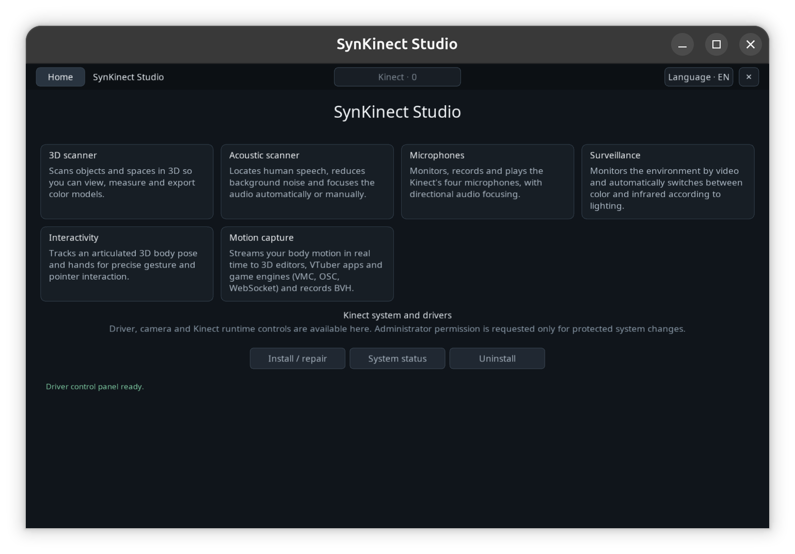

<div align="center">

# SynKinect Studio

### Capability-driven desktop Studio for Kinect Remold runtimes

[Project overview](../../../README.md) · [Documentation](../../../docs/README.md) · [Module SDK](../../studio-module-sdk/README.md)

</div>

`SynKinectStudio.pde` is the Processing application entry point for the Kinect Remold project. The Studio includes six built-in modules and can load additional modules in the same window:

- **3D Scanner** — one Capture surface supports **Turntable** and **Kinect Fusion**, with capture deliberately separated from dense reconstruction. **Scan** performs foreground Depth lock, lightweight temporal ICP, realtime angle/view coverage, quality checks and RGB-D keyframe retention; it does not update a TSDF or run global reconstruction. Turntable coverage is confirmed directly from tracking (including crossed angular sectors), so 360° detection cannot fall behind a slow fusion step. Fusion records keyframes and a camera trajectory around the Depth-locked subject and derives capture progress from viewpoint diversity, not touched voxels. A full turn pauses capture; there is no Finish command. **Build Mesh** is the first dense/offline reconstruction, while **Refine HQ** reruns the retained source keyframes through organized multiscale ICP, loop closures, SE(3) pose-graph optimization, deformation graph, Surface-SDF and final polish. The Scanner consumes the shared Sensor Calibration profile instead of owning a second calibration path.
- **Acoustic Scanner** — four-microphone band-limited SRP/GCC-PHAT localization with per-pair reliability weighting, temporal source tracking, voice activity detection, AUTO/MANUAL beamforming, adaptive spectral noise suppression and output-only voice enhancement for clearer, louder speech.
- **Microphones** — four-channel monitor, runtime status and raw-channel recording, with its own output state using the same voice-aware localization, beamforming, noise suppression and voice-enhancement pipeline as Acoustic Scanner.
- **Surveillance** — all-connected-Kinect adaptive video surveillance: RGB in normal light or IR in low light, never Depth, with hysteretic light-mode selection, a minimum 60-second automatic mode hold, appearance/luminance motion detection, a compressed 10-minute RAM ring per camera and synchronized internal MJPEG/AVI event recording.
- **Interactivity** — configurable RGB MoveNet ONNX body tracking or metric-depth SynSkeleton ONNX tracking, per-hand interaction zones, push-to-click, two-hand right click / double click / scroll and a two-hand air keyboard, driving the desktop pointer on Windows and Linux.
- **Motion Capture** — streams the same body tracking in real time as VMC (OSC/UDP), plain OSC, JSON over UDP or WebSocket to VSeeFace, Unity, Blender, Unreal and custom tools, and records BVH files. See [`docs/MOTION-CAPTURE.md`](../../../docs/MOTION-CAPTURE.md).

<p align="center">
  
</p>

In RGB mode, MoveNet provides body landmarks but not detailed finger tracking. Depth mode requires compatible models exported by Kinect DepthAutoLearn. Refer to [tracking configuration](../../../docs/TRACKING-MODES.md); model weights are not included.

The current Home surface presents the six built-in modules—**3D Scanner**, **Acoustic Scanner**, **Microphones**, **Surveillance**, **Interactivity** and **Motion Capture**—as capability cards. Below them, the **Kinect system and drivers** section exposes **Install / Repair**, **System status** and **Uninstall** without mixing protected system operations into the individual sensor tools. Administrator permission is requested only when a protected system change actually requires it. Current captures for Home and every built-in module are maintained under `docs/images/`, so the project overview and technical documentation share the same visual source.

Open modules from the Home cards. The top bar is intentionally limited to Home, Kinect selection and LANguage so every module receives the same navigation shell. Home uses an automatically flowing card grid backed by a scroll viewport: built-in and newly loaded modules are inserted with the same title/description cards, the grid chooses its column count from the available width, and the mouse wheel or draggable scrollbar reaches additional rows without moving the shell title. The Kinect system/driver controls follow the module grid at their natural content height instead of reserving a large empty panel. All built-in modules use the shared `StudioUi` component system for panels, metric blocks, buttons, status footers, responsive spacing and localization-safe text fitting while preserving the established appearance: one single-line module header followed by titled cards for previews, status and action/control groups. Specialized preview canvases remain module-owned, while reusable front-end controls and resize behavior are host-owned. Interactive buttons stay inside action/control panels instead of floating in or below the header. The top-level Kinect control selects the device used by single-camera modules and shows the detected model plus the selected/total count, for example `Kinect 1473 · 2/2`. An explicit selector change is treated differently from an automatic reconnect: it immediately drops frames from the previous sensor, closes that sensor's active module transports and reconnects Scanner, Interactivity, Motion Capture, Acoustic and Microphones to the newly selected stable `device-id`. The device registry lists physical sensors independently of camera-endpoint readiness; a sensor may remain selectable while its video transport is re-enumerating, and video-dependent modules wait for that sensor's endpoint instead of removing the sensor from the Studio. **3D Scanner opens its own RGB + metric-Depth session for the selected Kinect; Interactivity and Motion Capture each open their own depth-only body-tracking session.** Xbox 360 uses its native 640×480 profile; other generations allocate previews and processing buffers from the dimensions advertised by their driver module and frame headers. Surveillance is deliberately different: while the module is active it monitors every device in the central registry concurrently. RGB and raw IR share one physical Kinect video engine. Foreground Surveillance owns that arbitration and subscribes exactly one video stream: RGB in normal light or IR in low light. It never subscribes Depth. Leaving the Surveillance module disarms it and releases video ownership so other modules are not blocked.


## Frontend language and visual consistency

Built-in modules use the shared Studio UI vocabulary and renderer: sentence-case labels, a common `Status` summary panel, consistent state words, verb-first action labels, unified hover/selected button feedback, and host-owned native file/folder dialogs. Proper technical abbreviations such as RGB, USB, ICP, IMU, HQ, WASAPI, STL/OBJ/PLY and XYZ retain their conventional capitalization. See [`docs/STUDIO-UI-STYLE.md`](../../../docs/STUDIO-UI-STYLE.md).

## Multi-generation device model

SynKinect Studio registers Kinect driver modules independently. The current registry contains `kinect-xbox-360-remold` (`generation=xbox-360`) and `kinect-one-remold` (`generation=xbox-one`); future generations can add another module endpoint without replacing or aliasing either runtime. Devices are keyed internally by `module-id + native device-id`, while module-independent features consume advertised camera, control, audio and SDK capabilities. External Studio modules receive the same qualified identity through `StudioDeviceInfo`.

## Instance-owned Studio runtime

The Studio shell and `StudioUi.pde` provide the frontend and instantiable UI blocks; each module (built-in or external JAR) provides its backend and composes those blocks. `ProcessingBlocks.pde` (`StudioProcessingBlocks`) centralizes construction of the shared processing blocks: RGB-D with depth calibration (`openRgbd`), SynSkeleton (`openSkeleton`), body tracking (`openBodyTracking`), Scanner reconstruction (`openScanner`) and spatial audio. `Interactivity.pde` and `MotionCapture.pde`, for example, consume `BodyTrackingSession` snapshots and keep only desktop control or retargeting/streaming. The file layout is listed in [`docs/MODULE-LAYOUT.md`](../../../docs/MODULE-LAYOUT.md#studio-source-layout).

`SynKinectStudio.pde` keeps the Processing callbacks only as the required `PApplet` host boundary. The Studio itself is a `StudioController` instance that owns the built-in and loaded `StudioModule` instances. Each module has instance lifecycle methods for initialization, activation, deactivation, drawing, input and disposal. Protocols, themes, transports, UI objects and the 3D viewport are also normal object instances; the PDE contains no `static` declaration.

Module switching is asynchronous. The render/UI thread only requests a target module; a dedicated lifecycle worker releases the current native transport and activates the latest requested module. Rapid module changes are coalesced, so blocking pipe/socket shutdown and worker joins never run in the Processing draw/input thread.

Scanner, Interactivity and Motion Capture use independent camera transport instances. They reuse the same calibration math, but never share a live RGB-D connection. Leaving a module invalidates and closes its transport immediately; the superseded worker retires by session generation and cannot stop a newly opened module. Body tracking consumes only the newest depth frame on its own worker and publishes immutable snapshots, keeping the Processing render thread free of camera I/O and heavy CV work.

Surveillance owns all discovered Kinect video streams only while the module is active. Leaving Surveillance disarms monitoring, stops any active event asynchronously and releases RGB/IR ownership so Scanner or Interactivity cannot be blocked by a hidden video consumer. While active, every discovered Kinect owns an independent RGB-or-IR subscriber, appearance/luminance motion detector and compressed JPEG retention ring in RAM. The RGB-to-IR transition uses luminance hysteresis and a short persistence window so IR engages while the scene is already dim, before color becomes nearly black, without oscillating around the boundary. When Surveillance is already in IR mode and motion is confirmed, it attempts a bounded RGB probe only after the mode hold expires; usable color keeps RGB active, while darkness, a failed RGB subscription or a probe timeout automatically restores IR. Ambient-light recovery remains a slower secondary RGB probe path. Arming surveillance resets the motion background and starts a short stabilization period; events require coherent spatial change sustained across multiple frames, rather than isolated sensor noise or the previous unarmed motion state. The default ring is **10 minutes** and every event flushes **60 seconds of pre-roll** per camera before appending live frames. Motion from any camera starts one global event containing one compact MJPEG/AVI file per connected Kinect. The AVI writer is part of the Studio and starts no external encoder process.


## Application-local language and data layout

LANguage selection is global in `StudioController`/`StudioShellI18n`. The top bar contains exactly three aligned controls: Home, the centered Kinect selector, and LANguage. Module names are not duplicated in the top bar; modules are opened from Home. The configured order is `en-US`, `pt-BR`, `es-ES`, `fr-FR`, `de-DE`, `it-IT`, `ja-JP` and `zh-CN`. **English (`en-US`) is the package default.** Chinese uses Simplified Chinese (`zh-CN`). On a first launch with no saved preference, the Studio starts explicitly in English (`en-US`), independent of the operating-system locale. After the user selects a language, that choice is stored in the operating-system user preference store and restored on subsequent launches. The Studio uses Java's Unicode-capable logical sans-serif family so Latin, Cyrillic and CJK text share one typography system with platform font resolution.

Resources are separated by application instead of sharing one monolithic catalog. Each built-in application owns its configuration and locale package:

```text
data/
  studio/         config/config.properties, config/driver-modules.properties, resources/i18n/<locale>.properties
  scanner/        config/config.properties (Scanner, RGB-D core, depth calibration), resources/i18n/
  acoustic/       resources/i18n/
  microphones/    config/config.properties, resources/i18n/
  surveillance/   config/config.properties, resources/i18n/
  interactivity/  config/config.properties, resources/i18n/
  mocap/          config/config.properties, resources/i18n/
  skeleton/       SynSkeleton.onnx + SynSkeleton_layout.json + config/config.properties
  spatial-audio/  config/config.properties (shared audio DSP)
```

Generated data is stored in the current user's writable application-data area, separate from packaged `data/` resources. On Windows the default root is `%LOCALAPPDATA%/Kinect Remold/Data/SynKinect Studio/`; on Linux it is `$XDG_DATA_HOME/Kinect Remold/Data/SynKinect Studio/` or `~/.local/share/Kinect Remold/Data/SynKinect Studio/`. Scanner exports, depth-calibration profiles, Microphones recordings, Surveillance events, Motion Capture BVH files and external-module output are created below that root. `-Dkinect.remold.userData=<path>` overrides the root. Small user-interface preferences that must survive application upgrades, including the selected language, Interactivity control hand and Interactivity tracking category, use the Java user preference store.

## Responsive typography

`studioUiScale()`, `studioTypographyScale()`, `responsiveFontSize()`, `fitCurrentTextSize()` and `ellipsizeToWidth()` are the shared typography policy. Base font size follows the actual window dimensions with a dedicated viewport-aware typography scale. Text that lives inside a finite control is then fitted against that control's real width/height, with an ellipsis only if the configured minimum size still cannot fit. Buttons, cards, metrics, pills, status rows and Interactivity fields use this policy.

## Module visual ownership

The host owns structural UI rules: content width, panel columns, panel/button/metric maximum widths, gaps, responsive typography and generic hit testing. Built-in and external modules therefore receive the same spacing behavior without module-name exceptions. A module owns only specialized visualization and domain presentation that cannot be expressed with the shared `StudioUi` components. Built-ins may define domain-specific button labels/actions, but their geometry is delegated to the same layout engine used by declarative external modules.

## Shared RGB-D session

`RgbdCore.pde` exposes an independent RGB-D session boundary (`RgbdSession`) for modules that need synchronized RGB and/or metric depth. It combines the `KinectSource` transport (`RgbdTransport.pde`), the ScannerPort protocol and RGB HQ processing (`RgbdProtocol.pde`), `Calibration` with the per-device depth-correction profile (`DepthCalibration.pde`) and RGB↔Depth registration (`RgbdRegistration.pde`); `CoreConfig.pde`, `CoreMath3D.pde` and `CorePointCloud.pde` hold the shared configuration, math and point-cloud types. A module owns its own session, obtained through `studio.services.processingBlocks.openRgbd(...)`, and can select a Kinect without depending on another module's lifecycle. Shared frame types live at this boundary so modules consume RGB-D data without importing Scanner UI or Scanner state.

## Shared spatial-audio library

`SpatialAudio.pde` is the shared per-Kinect spatial-audio runtime used by the built-in audio modules. Exactly one `SpatialAudioDeviceSession` owns the raw 4-channel transport, frame decode, localization and human-voice/VAD analysis for each `device-id`; Acoustic Scanner and Microphones attach as independent consumers of that same immutable frame/analysis stream. Each consumer owns independent beamforming, spectral-noise-suppression and voice-enhancement output state. Voice enhancement runs only after beamforming/suppression and consists of a low-cut stage, speech-weighted presence lift, speech-aware automatic gain and soft compression, so playback can be clearer and louder without modifying the raw four-channel bus. Shared tuning lives in `data/spatial-audio/config/config.properties`. Additional modules can attach to the same per-device session without opening a second microphone transport.

## Shared SynSkeleton library and body tracking

Body tracking is implemented as **SynSkeleton**, a Studio-wide neural tracking service. `StudioServices.skeletons` creates a `SkeletonProcessingSession` for each module/device; every session loads the same `data/skeleton/SynSkeleton.onnx` model and owns only its own inference/stabilization state.

`SynSkeletonOnnx.pde` is the authoritative pose backend. It consumes metric Depth, runs the model at `1×1×240×320`, maps the 58 output landmarks through the active depth calibration into camera-space XYZ, and derives the canonical shoulder-center, spine, hip-center, palms and feet required by the Studio API. No alternate geometric/articulated pose solver is selected when the model is unavailable. See [`docs/SKELETON-3D-ARCHITECTURE.md`](../../../docs/SKELETON-3D-ARCHITECTURE.md).

`BodyTracking.pde` wraps one depth-only `RgbdSession` plus one SynSkeleton session on a latest-frame worker as the reusable **body-tracking block** (`studio.services.processingBlocks.openBodyTracking(...)`). UI code polls `latest()`; module backends `subscribe()` and receive immutable `BodyFrame` snapshots through their own latest-only mailbox, so a slow consumer never blocks the solver. The block also provides `BodySkeletonPreview`, the body-centric metric depth/3D skeleton view shared by Interactivity and Motion Capture. It follows a damped torso anchor, safety-fits only when necessary to keep the complete measured body inside the panel, hard-clips rendering to that panel and resets presentation state when a body-tracking session/device is restarted. External modules reach the same block through `StudioModuleContext.bodyTracking(deviceId)`.

Every joint stores image coordinates, camera-space XYZ metres, confidence, tracking state and an orientation quaternion. The canonical pose carries the 20 body joints, optional Kinect-v2-style hand tip/thumb joints and a 21-landmark detailed hand per side. SynSkeleton is an in-Studio service consumed through the current Module API; no historical skeleton relay transport is exposed.

## Interactivity pipeline

Interactivity opens one `BodyTrackingSession` (full-FOV metric Depth, no RGB) while its tab is active. `Interactivity.pde` holds the desktop controller (`InteractionDesktopController`) and presentation; `InteractionControl.pde` holds the per-hand model, One-Euro filters and the air keyboard. Each hand owns an interaction zone anchored at its shoulder and sized by arm length (`zone.*`); a hand controls only when raised in front of the body (`engage.*`). A relative push toward the sensor clicks (`press.*`), the second hand adds right click, double click and joystick-style scroll (`gesture.*`, `scroll.*`), and holding both hands above the head toggles an on-screen keyboard on which both hands type (`keyboard.*`). All keys live in `data/interactivity/config/config.properties`; see [`docs/INTERACTIVITY-CONTROLS.md`](../../../docs/INTERACTIVITY-CONTROLS.md).

The tracking category (**Auto**, **Body / hands**, **Hands & fingers**) selects how the same SynSkeleton hand landmarks are used by Interactivity; the hand selector cycles **Auto → Right → Left**. Both are stored in the operating-system user preference store. Pointer XY is anchored to the refined palm or the body hand, never to a fingertip. The 3D view uses a fixed nominal metric frame referenced to 1.10 m. Its presentation origin follows the body and a bounded safety fit can zoom out to keep the measured body inside the panel; it never depth-zooms or feeds viewport scale/centering back into tracking. Losing tracking, disabling control or changing modules releases held input state.

## Motion capture pipeline

`MotionCapture.pde` owns one `BodyTrackingSession` while its tab is active. `MocapRetarget.pde` converts each `BodyFrame` to a Unity humanoid pose (gravity-aligned, floor at Y = 0, optional mirror) and `MocapSinks.pde` sends it through the enabled VMC, OSC, JSON-UDP and WebSocket sinks or records BVH, each sink on its own thread with a latest-only mailbox. Settings are in `data/mocap/config/config.properties`; leaving the tab closes all sockets and finalizes a running recording. See [`docs/MOTION-CAPTURE.md`](../../../docs/MOTION-CAPTURE.md).


## Compact surveillance video

Each connected Kinect owns an independent ScannerPort endpoint and remains visible in the Studio device selector while its physical identity is present. The Windows installer requires the Remold private camera interface on every physical `02AE`; generic WinUSB alone is not treated as a complete camera installation. The Broker SDK is the Studio discovery source. The runtime refreshes its internal device manifest continuously, and the Studio tolerates a 3-second SDK reconnect interval before removing a previously observed device. During that interval the device state becomes `reconnecting` and no stale camera endpoint is advertised. This prevents normal 02AD→02BB/02C3 firmware re-enumeration, 02AE PnP rebinding or a CameraBridge service restart from collapsing the complete multi-Kinect list. Surveillance renders all connected cameras in a grid and records one AVI per camera inside the same event directory.

For concurrent live streams, USB host-controller bandwidth remains a hardware constraint. Kinect Xbox 360 was specified around a dedicated USB 2.0 bus; when several sensors share one controller, Windows can reject or starve isochronous bandwidth even though all sensors are correctly enumerated. In a multi-Kinect installation, CameraBridge therefore keeps each inactive sensor at zero streaming bandwidth and closes the physical RGB/Depth session when that sensor has no ScannerPort or virtual-camera consumer. Selecting another Kinect releases the previous session before the new sensor retries its stream. Separate root USB controllers/PCIe USB controllers are still recommended when several sensors must stream simultaneously.

Surveillance writes to the per-user `surveillance/recordings/event-YYYYMMDD-HHmmss/kinect-<device-id>.avi` with Motion JPEG plus an `event.properties` manifest. Video compression and AVI indexing are implemented inside the Studio; FFmpeg is not used. The pre-roll source is the in-memory compressed ring; temporary camera disconnects preserve already-retained frames and a reconnect with the same stable device ID rejoins the same event recorder.

## Window-close safety

Keyboard shortcuts are not used by the built-in Studio modules. Processing's default ESC-to-exit path is disabled so accidental key input cannot close the application. The JOGL native window uses `DO_NOTHING_ON_CLOSE`, and all close requests are routed through the Studio policy. If Surveillance is armed or recording, the close request is rejected and a localized warning is shown. After Surveillance is disarmed, the same close button exits normally.

## Window resize and pointer coordinates

The Studio opens at **1440×900** and enforces that same size as its minimum resizable window. Shared `StudioUiSystem` axis allocators distribute panel groups within the exact available rectangle, shrink gaps before content, and only compress component minima as the final layout step; child button and metric grids never reserve geometry outside their host panel. The Studio uses the normal operating-system frame and title bar. It deliberately does not call `GLWindow.setUndecorated()`, hide/show the native peer, or recreate the window after startup; moving, resizing, minimizing and maximizing are handled by the OS. The internal Studio top bar continues to provide application navigation, device selector, language control and its orderly close action. The shell reserves the top `STUDIO_TOP_BAR_H` pixels for navigation and renders each module after translating the canvas into content space. Pointer input uses the inverse transform exposed by `StudioController.contentMouseX()/contentMouseY()`; modules must not read global `mouseX`/`mouseY` directly for content controls.

## 3D viewport containment

The 3D Scanner reconstruction environment is rendered by an instance-owned off-screen `PGraphics(P3D)` viewport. Grid, axes, point cloud and mesh are rendered into that buffer and then composited into the reconstruction card as one image. This prevents camera/projection/depth state from leaking into the Studio renderer or drawing outside the panel. The viewport is recreated to match the actual panel dimensions after a window resize, so the UI follows the generated window size rather than a fixed design-time height.

## Application icon

The SynKinect Studio icon asset is maintained with the application source. The sketch contains Processing export icon sizes (`icon-16.png` through `icon-512.png`), keeps `data/studio/resources/synkinect-studio-icon.png` as the runtime window icon, and embeds the same PNG in the unified application JAR as an application resource. The full Kinect hardware reference image is kept separately under `../../../docs/images/`. Windows is packaged as a native `jpackage` application image. Linux stages the runtime script, PNG icon and `.desktop` entry from `../../runtime-templates/`. Build artifacts are created under the build output tree; application-generated data is kept in the owning per-user application-data directory.

## Raw camera boundary

ScannerPort uses GRBG8 Bayer RGB, packed 10-bit IR and packed 11-bit Depth. The Studio rejects decoded camera wire formats instead of selecting alternate decoders. RGB demosaic, IR unpack/crop and calibrated Depth conversion are performed in the module-side processing layer. Module objects are instantiated independently at startup, but transports remain closed until the corresponding module is activated.

## Linux/Processing runtime interface

The application uses one local transport contract for Windows named pipes and Linux Unix-domain sockets. Both use the same configured open-attempt count, retry delay and connect/read/write timeout budget. Transport shutdown is idempotent and actively closes both input and output sides so worker threads do not remain blocked while changing modules or closing the program. Driver modules are queried independently during discovery, and the device registry applies the same refresh cadence and transient-disappearance grace period on both operating systems. Runtime transport reads are capped at 3 seconds, disappeared devices use a 3-second grace period, and discovery refreshes every 500 ms so physical unplug or transport loss is surfaced quickly on both operating systems.

## 3D scanner low-latency pipeline

Scanner buffering is bounded and prioritizes current capture data:

1. the native camera bridge keeps bounded FIFO queues per RGB/IR/depth stream;
2. `KinectSource` keeps bounded RGB/depth synchronization history and publishes synchronized `RgbdFramePair` objects;
3. the Processing render loop drains several available pairs per tick, while preview metrics and RGB preview conversion are paid only for the newest drained pair;
4. active reconstruction keeps a small bounded latest-frame window and drops the oldest pending reconstruction item if fusion falls behind;
5. ICP tracking is restricted to the locked 3D Bounding Box. When synchronized RGB is available, calibrated RGB-D color similarity contributes a bounded correspondence weight; if RGB is unavailable or out of sync, tracking automatically falls back to depth-only ICP;
6. TSDF reset/initialization runs on the reconstruction worker; **Scan** does not clear the reconstruction volume on the Processing render/UI thread.

Queue sizes and drain rate are configurable in `data/scanner/config/config.properties`. The real-time profile uses a 3-frame ICP reference window, keeps only the newest pending reconstruction job, retains up to 3 published RGBD pairs and 6 synchronization-history frames, and preserves the configured 192³ TSDF volume. Native and Processing frame numbers are monitored so transport gaps are visible instead of being silently hidden.

The single **Scan** control is stateful: it starts capture, becomes **Pause**, and becomes **Resume** while paused. A completed Turntable revolution only pauses capture. Capture stores keyframes and a bounded point-cloud preview; it never creates the final volume. **Build Mesh** performs the first balanced offline reconstruction from the captured keyframes. **Refine HQ** runs the maximum-quality offline engine from those same source keyframes. **Clean**, **Smooth** and **Center** operate only on the current mesh, while **Undo** restores prior mesh edits. Exports refuse stale geometry and can trigger a rebuild when the capture has changed since the last mesh.

## High-quality final reconstruction

No dense TSDF is maintained during Scan. Usable full RGB-D keyframes are retained as the source dataset while the realtime loop performs only motion/coverage estimation and bounded point-cloud preview. **Build Mesh** creates a fresh balanced reconstruction offline; **Refine HQ** performs the full-quality reconstruction from the retained keyframes. Frames that cannot reach geometric consensus are excluded instead of being baked into the output.

### Scanner color transport

The live Scanner keeps 640×480 metric Depth as its geometry baseline. RGB resolution is owned by the selected Kinect driver instance: when **RGB HQ** is enabled in the Studio system/driver panel or through `KINECT`, the Scanner follows that setting and consumes the native 1280×1024 Bayer color stream without changing Depth geometry. High-quality reconstruction continues to use calibration, robust registration, multi-view fusion and the HQ TSDF build; if the HQ transport stalls, the camera session is restarted without silently changing the selected RGB mode.


## Compact mesh export

The Save action uses the host-owned native dialog service and suggests `SynKinectScan.stl`, `.obj` or `.ply`. On Windows this is the native Explorer/Win32 save dialog; Linux uses the native desktop chooser available on the host.

Exports run outside the capture/render thread. The save dialog starts in the user's writable Scanner output directory, the selected extension is enforced, the destination directory is validated before writing and a zero-length/missing result is treated as an export failure. Before writing, the mesh is converted to an indexed representation, nearby vertices are welded, degenerate/duplicate faces are removed and triangle count is bounded with conservative geometric clustering. PLY is binary little-endian. OBJ stores indexed geometry, normals and the RGB vertex colors accumulated from the Kinect scan itself. STL remains binary and uses the compacted face set.

Important export settings in `data/scanner/config/config.properties`:

```properties
export.weldToleranceM=0.0010
export.maxWeldToleranceM=0.004
export.maxTriangles=600000
```

Increase `export.maxTriangles` or reduce `export.weldToleranceM` when maximum geometric detail matters more than file size.

Surveillance uses an adaptive per-frame JPEG budget (10 KiB by default at 320×240 / 5 fps), targeting roughly **2.9 MiB per minute** before small AVI container overhead while retaining standard MJPEG/AVI playback.

### Scanner sensor options

The Scanner capture bar exposes **SENSOR CALIBRATION** only; it does not own RGB HQ state. Per-device depth calibration (`DepthCalibration.pde`, `calibration.depthCorrection.*`) is enabled by default: a smooth, distance-aware correction fitted from flat-wall captures at several distances, with an optional tape reference for absolute scale (see [`docs/SENSOR-CALIBRATION.md`](../../../docs/SENSOR-CALIBRATION.md)). It improves valid depth samples but cannot create measurements inside the physical sensor's invalid/zero-depth region. RGB HQ is a persistent per-Kinect driver setting controlled from the Studio system/driver panel or `KINECT`. The Scanner follows that setting. On Windows 11 the native virtual-camera output renegotiates its advertised format when clients reopen; Windows 10 uses the local MJPEG image backend instead.


## Module API

External modules implement `org.synkinect.studio.api.SynKinectStudioModule` and are discovered from trusted JAR files in the packaged `modules/` directory through Java `ServiceLoader`. The public API is maintained under `applications/studio-module-sdk/` and is built as `SynKinectStudio-module-api.jar`.

The Studio registry treats built-in and external modules through the same string identity and lifecycle interface. Runtime active/ready checks for built-in hardware state use instance identity rather than fixed navigation indexes or module-name comparisons. The host dispatches language, Kinect-selection, input and close-policy behavior through generic lifecycle/context interfaces: initialized modules receive `StudioContextEvent` notifications and decide internally how their own resources react. Module state is installed in a type-keyed instance store rather than fixed fields in `StudioController`, so adding another built-in state type does not change the controller.

Built-in modules remain first in navigation. Loaded modules receive `StudioModuleContext`, which provides the Processing host, locale, device snapshots, per-Kinect audio/control endpoints, public Remold endpoints, local transport access, saved depth calibration, host-owned body tracking (`bodyTracking(deviceId)`), per-module data storage, logging and managed workers. New modules can be backend-only: returning a declarative `StudioModuleUi` lets the host build and resize panels, metric blocks, buttons, status areas and hit targets automatically. The current module API provides generic context-change, mouse-release and close-guard hooks. The loader accepts only the current API version. Custom `draw()` remains optional for specialized graphics. Module JARs execute in the Studio process with the Studio user's operating-system permissions.

### Folder selection and generated data

Scanner STL/OBJ/PLY actions always open the host-native save-file chooser and remember the last export folder. Microphones and Surveillance use the same host-owned native dialog service for recording-directory selection. On Windows, directory selection is delegated to the Windows Shell/Explorer; on Linux the frontend requires an installed native chooser: `zenity`, `kdialog` or `yad`. The chooser is opened without a forced initial directory, so the operating system is free to present its normal/recent location instead of always starting in Downloads. Selected destinations are still stored as per-user preferences for subsequent recordings without changing packaged configuration.

### Generation capabilities

Device discovery accepts optional capability and stream metadata after the base SDK columns: `capabilities, color-width, color-height, depth-width, depth-height, ir-width, ir-height, color-fps, depth-fps`. Xbox 360 publishes its fixed profile. The Kinect Remold Xbox One module publishes its native camera profile and only capabilities implemented by its runtime. The Home hardware controls are built from the selected device capabilities rather than the generation name. Tilt, startup tilt, RGB-HQ, IP, calibration and camera actions appear only when the selected runtime advertises the capability required by that action. Generation remains transport metadata, not a UI permission list. RGB previews allocate from the received frame size, and the RGB-D transport accepts native metric 16-bit Depth in addition to the Xbox 360 RAW11 path. For Kinect One, the Scanner session also subscribes IR alongside RGB + Depth; body tracking subscribes Depth only, and Surveillance may request IR directly. Native Kinect One depth intrinsics are applied dynamically at the received 512x424 geometry, so deprojection, ICP and body tracking do not reuse Xbox 360 640x480 assumptions. The Kinect One camera runtime does not advertise audio because that path is not implemented there.

### Module/plugin architecture

Studio modules are optional plugins. The six modules shipped in the source tree are registered in `Modules.pde` (`builtinStudioPlugins()`), use the same `StudioModuleBase` lifecycle registry and can be removed from the shell with `studio.modules.enabled` in `data/studio/config/config.properties`. The default is `scanner,acoustic,microphones,surveillance,interactivity,mocap`; removing an id prevents that module from being instantiated. No shell feature may rely on a module's array position.

Installable third-party modules remain JAR plugins discovered from the Studio `modules` directory through `SynKinectStudioModule`. They may be added or removed without changing the shell source. Built-in and JAR modules share setup, activate, deactivate, draw, input, context-change and dispose lifecycle semantics; external JARs additionally receive an isolated `StudioPluginContext` and tracked worker cleanup.


## Host-owned frontend / backend-oriented modules

Reusable presentation belongs to the Studio host. `StudioUiSystem`, `StudioUiModuleFrontend`,
`StudioUiPanel`, `StudioUiButton`, `StudioUiMetric`, `StudioUiRenderer` and `StudioNativeDialogs` define responsive
layout, panel chrome, typography, interaction feedback, capability-aware controls, status/location
footers, native save/folder selection and visualization framing. Built-ins retain their characteristic Scanner/radar/meters/
surveillance/body content while instantiating the common frontend. `StudioPalette` (`StudioUi.pde`) is the single colour palette; module `*Theme` classes extend it and add only module-specific colours. File/folder dialogs are therefore a frontend service, not a module-specific implementation detail.

External JAR modules can remain backend-oriented through `StudioModuleUi`. The public API now
also supports `StudioModulePanel.Visual` plus `StudioModulePanel.visual(...)`: a plugin publishes
an immutable ARGB frame and the host owns clipping, fitting and presentation. Direct Processing
drawing remains compatible, but declarative host-rendered UI is the preferred path for new modules.


### Reusable frontend toolkit

The declarative plugin frontend additionally provides host-rendered progress bars, tables,
forms/fields, logs and spacers alongside text, metrics, actions and ARGB visual frames. This gives
future adapters (including Python processes) enough primitives to build useful modules without
shipping a second GUI toolkit. Module-specific visualization remains possible through visual
frames while the Studio retains layout, typography, interaction and theme ownership.

See `applications/studio-module-sdk/PYTHON-PLUGIN-BRIDGE.md` for the intended process/IPC boundary.


### Scanner precision and presentation orientation

The 3D Scanner rejects locally unstable depth samples and uses reciprocal robust ICP before TSDF integration.

Observer-facing visual orientation: camera/depth previews, the 3D body view, live/reconstructed Scanner 3D views, Surveillance tiles and the acoustic radar use one consistent horizontal presentation for a Kinect aimed at the subject. This is presentation-only: calibrated camera coordinates, tracking, ICP/TSDF reconstruction, exported geometry and raw acoustic azimuth remain in native sensor coordinates.

## Realtime scan performance

The live acquisition path is deliberately latency-bounded. Capture may run faster than reconstruction, but the reconstruction worker keeps the newest pending RGB-D pair instead of replaying stale frames. An adaptive reconstruction cadence uses measured processing time to leave CPU headroom instead of running the worker continuously when the current scene becomes more expensive. This prevents UI lag from becoming pose lag.

Tracking uses the lighter point-cloud sampling first. The denser integration cloud, RGB registration and TSDF color work are built only for poses that are actually eligible for integration. Turntable uses depth geometry as the default realtime tracking authority and reserves registered RGB for accepted fusion frames. Kinect Fusion uses a bounded point-to-plane sample budget against a cached near-surface TSDF model; full TSDF raycast checks are reserved for relocalization/consistency. Turntable caches its rolling reference index, concentrates reciprocal checks in the final ICP iterations and interleaves full yaw search with temporal prediction. The final/offline HQ reconstruction keeps its independent high-quality settings.

The live point-cloud preview has its own point budget and refresh cadence, so visualization cannot consume the same CPU budget needed by ICP/TSDF. Kinect Fusion coverage is cached for several accepted integrations because scanning all touched TSDF voxels every tracking frame does not improve pose accuracy. Dynamic volume expansion is also checked periodically rather than on every integration.

These optimizations change scheduling and realtime sampling, not the metric calibration or final HQ reconstruction. If capture outruns reconstruction, intermediate frames may intentionally be skipped; the newest geometrically useful frame is preferred.

## Module presentation and backend lifecycle

The Studio host owns navigation, fonts, responsive panels, hit testing, scrolling,
and module activation. Both built-in modules and external JAR modules share
`StudioModuleBase` as their lifecycle boundary. A module may publish an immutable
`StudioModuleUi` through `uiSnapshot()` and handle actions in `uiAction()`; the
host renders the snapshot using reusable UI blocks. Built-in modules that require
advanced realtime visuals can continue to use their specialized renderer until
those visuals have an equivalent host block.

External modules provide `ui(localeTag)` and `action(actionId)` through the
public SDK. Only one module is active at a time, and instances own their mutable
state and workers. The existing scanner, microphone, acoustic, surveillance,
interactivity and motion-capture visualizations remain specialized host modules.

External JAR modules execute in-process with Studio privileges. Only install
trusted modules. Module API compatibility metadata is `1`.


The current screenshots of all six built-in modules, including Motion capture, are under `../../../docs/images/`. The screenshots depict interface states observed during capture and are not evidence of successful hardware operation.

### Live preview stability

The Scanner uses a short-lived temporal voxel preview to reduce transient depth holes before capture. This visual stabilization does not change raw RGB-D keyframes, ICP, TSDF or exported geometry.

The Interactivity and Motion capture 3D viewers frame the scene from valid tracked body joints instead of fluctuating outer depth-cloud samples. Their point clouds are still rendered normally, and the pose, input-control, recording and streaming data are unchanged. Surveillance records incoming frames without temporal accumulation, while Microphones and Acoustic scanner keep their live audio timing and samples unchanged.
