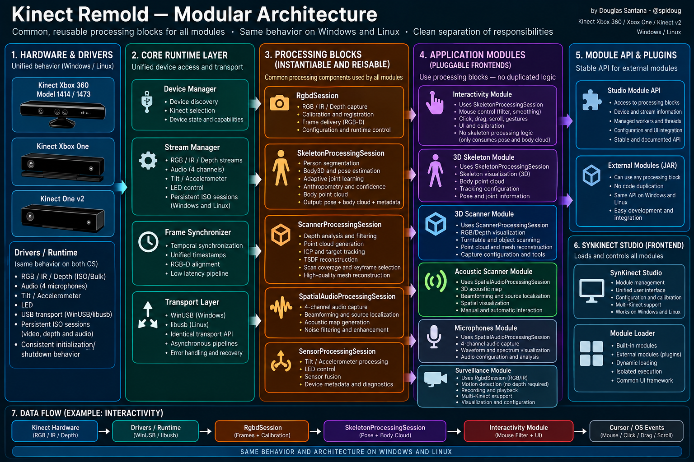

<div align="center">

# Architecture

### Cross-platform ownership, stable device identity and capability-driven Studio integration

[Documentation](README.md) · [Quick start](QUICKSTART.md) · [Unified device contract](UNIFIED-DEVICE-CONTRACT.md) · [Motion](MOTION.md) · [Protocols](windows/PROTOCOL.md)

</div>

## Design goal

<p align="center"></p>

Kinect Remold separates the cross-generation application layer from generation-specific native driver modules. SynKinect Studio operates on discovered device capabilities and stable device identities; it does not own USB endpoints or assume that every Kinect generation exposes the same physical transport.

The key rules are:

> **Each driver module owns its generation-specific hardware. SynKinect Studio consumes stable per-device capabilities across all registered modules.**

The `kinect-xbox-360-remold` module supports first-generation models 1414, 1473 and Kinect for Windows 1517. The `kinect-one-remold` module owns Kinect v2 transport through WinUSB on Windows and libusb-1.0 on Linux. Both publish independent SDK endpoints without coupling Studio modules to generation-specific USB details.

### Discovery identity

Every discovered sensor is identified by the pair `module-id + deviceId`. The SDK row also publishes `generation` for diagnostics and transport specialization. User controls are selected from advertised capabilities; generation names do not decide which Home actions are visible.

## Product naming and generated paths

**Kinect Remold** is the product name. Generation names qualify modules rather than creating separate product brands: **Kinect Remold — Xbox 360** and **Kinect Remold — Xbox One**. Machine-facing identifiers such as `kinect-xbox-360-remold` and `kinect-one-remold` are module-scoped technical IDs; executable names, service IDs, named pipes and protocol symbols follow the module implementation rather than the product display name.

The source tree is treated as a first-distribution codebase. Installers operate only on current Kinect Remold locations and do not contain migration branches for pre-release product names or directory layouts. Runtime selection is explicit: hardware/topology mismatches fail or report unavailable capability instead of being silently remapped by historical heuristics. The intentional Windows camera compatibility path remains part of the supported camera design.

Generated user data, caches, logs and installed Windows runtimes share the `Kinect Remold` product root. Host-specific locations are resolved by the platform wrappers rather than embedded in executable source; `REMOLD_*` overrides can replace discovered locations. Windows persistent runtimes are stored under `C:\Program Files\Kinect Remold\<module-id>\`, shared runtime state under `%ProgramData%\Kinect Remold\`, and per-user Studio/build data under `%LOCALAPPDATA%\Kinect Remold\`. Linux keeps conventional machine-facing module paths such as `/usr/libexec/kinect-one-remold`; user cache/state/data directories use the `Kinect Remold` product folder below the applicable XDG root. Repository build publications remain under `binaries/<platform>/.../<module-id>/` because module IDs are stable technical identifiers, not display branding.

## Studio frontend / backend rule

SynKinect Studio separates presentation from processing with one rule:

> **The Studio shell and `StudioUi` provide the frontend and instantiable UI blocks. Each module, built-in or external JAR, provides its backend and composes host UI blocks. Shared processing lives in blocks created through `ProcessingBlocks`.**

| Layer | Owner | Contents |
|---|---|---|
| Frontend | Studio shell (`SynKinectStudio.pde`, `StudioController`) + `StudioUi.pde` | Top bar, Home cards, device selector, language, lifecycle worker, responsive layout, panels, metrics, buttons, status footers, native dialogs, typography and the single `StudioPalette` |
| Module backend | Each module (`Scanner.pde`, `Acoustic.pde`, `Microphones.pde`, `Surveillance.pde`, `Interactivity.pde`, `MotionCapture.pde`, or a JAR) | Module state, commands, sinks/recorders and domain presentation composed from host UI blocks |
| Shared processing | Blocks from `StudioProcessingBlocks` (`ProcessingBlocks.pde`, reached as `studio.services.processingBlocks`) | RGB-D acquisition + depth calibration + registration, SynSkeleton / body tracking, Scanner reconstruction, spatial audio |

The processing blocks are:

| Factory method | Block | Consumers |
|---|---|---|
| `openRgbd(...)` | `RgbdSession` (`RgbdCore.pde`): `KinectSource` transport, `Calibration` with the per-device depth-correction profile, `RgbDepthRegistration` | Scanner, Sensor Calibration, body tracking |
| `openSkeleton(rgbd)` | `SkeletonProcessingSession` (`Skeleton.pde` + `SynSkeletonOnnx.pde`): SynSkeleton ONNX inference, calibrated XYZ mapping, hands/fingers and pose-guided body cloud | body tracking |
| `openBodyTracking(...)` | `BodyTrackingSession` (`BodyTracking.pde`): depth-only `RgbdSession` + SynSkeleton on a latest-frame worker, immutable `BodyFrame` snapshots, latest-only subscriber mailboxes, shared `BodySkeletonPreview` | Interactivity, Motion Capture, external modules through `StudioModuleContext.bodyTracking(...)` |
| `openScanner(...)` | `ScannerProcessingSession`: depth analysis, point cloud, ICP, TSDF, coverage, HQ reconstruction | Scanner |
| `attachSpatialAudio(...)`, `newSpatialAudioEngine(...)`, `newSpatialAutoSteerer(...)` | `SpatialAudioDeviceSession`, `SpatialAudioEngine`, `SpatialAutoSteerer` (`SpatialAudio.pde`) | Acoustic Scanner, Microphones |

Surveillance intentionally keeps its own colour/IR capture path because it never owns Depth and has different arbitration/retention semantics. Its motion detector, retention buffer and recorder remain processing objects below `SurveillanceUI`.

`SpatialAudioEngine` keeps raw capture immutable and applies beamforming, spectral noise suppression and voice enhancement only to derived mono playback.

External JAR modules are coupled only to the Module API (`applications/studio-module-sdk/`): device capabilities, transport endpoints, saved depth calibration and the host-owned body-tracking session. Internal Processing classes are not part of that ABI, so the blocks can evolve without breaking third-party modules. The file layout is listed in [Module layout](MODULE-LAYOUT.md#studio-source-layout).

## Cross-platform boundary

Within each driver module, Windows and Linux follow the same ownership and application interfaces. Across generations, the Studio sees a registry of module endpoints and merges their per-device capabilities into one device selector.

```text
                         Applications
                              │
                    Remold application ABI
                              │
         ┌────────────────────┼────────────────────┐
         │                    │                    │
   Broker + SDK host     CameraBridge        AudioBridge
         │                    │                    │
 control + discovery     RGB / IR / Depth    UAC boot + 4ch bus
         │                    │                    │
         └────────────────────┼────────────────────┘
                              │
                   platform transport adapters
                    Windows           Linux
                 WinUSB/WASAPI       libusb/ALSA   
                 Media Foundation      V4L2
                              │
               generation-specific Kinect hardware
```

For the Kinect Remold — Xbox 360 module, the Broker owns both the model-neutral control endpoint and SDK discovery on both systems (`Named Pipes` on Windows, `Unix Domain Sockets` on Linux). CameraBridge is the sole camera owner and manifest publisher. AudioBridge is the sole audio boot/capture owner. Virtual-camera and IP-camera adapters consume those bridges rather than opening Kinect hardware independently. Applications never need to understand USB endpoints, ALSA device enumeration, WinUSB interfaces or Kinect firmware state.


## Kinect Remold — Xbox 360 hardware-control interface

The runtime presents one control interface for all supported first-generation Kinect models (1414, 1473 and 1517):

```text
status -> accelerometer + measured tilt (busy while a tilt is travelling)
tilt   -> requested degrees; reply distinguishes accepted from measured/verified
led    -> logical Remold LED mode
```

Reply `state` flags: `0x80000000` means the tilt was verified; `0x40000000` means the accelerometer fields are valid but the motor reported no usable angle (a 1414 reports tilt byte `0x80` while it moves). The Windows header names this flag `kStateTiltUnknown`, the Linux header `kStateTiltInvalid`. The camera service then clears `MotionTiltValid` in the frame's motion sample.

Both brokers resolve the model from the camera descriptor (`02AE` bcdDevice for 1414/1473, `02BF` for 1517) and serve every connection concurrently. The camera service is the only periodic `status` owner and attaches the latest valid sample to every frame; see [MOTION.md](MOTION.md).

The LED interface is also model-neutral and restricted to states both physical controllers implement natively: `Off`, `Green`, `Red` and `BlinkGreen`. `PrepareCamera` initializes a fresh physical control session to solid green on all three first-generation models. Later explicit LED commands remain in effect for that session. No model-specific color substitution is exposed through the SDK.

Connection details stay behind the broker backend. Model 1414 opens dedicated `045E:02B0`. Model 1473 preserves `045E:02C2 REV_0001` as the Microsoft hub and opens `045E:02BB/02C3&MI_00` after audio firmware re-enumeration. Model 1517 opens its dedicated `045E:02C2 REV_0100` motor/control function with the classic first-generation control protocol. Windows and Linux use the same model-neutral command/reply ABI. Model 1414 can verify movement through its dedicated motor endpoint; model 1473 treats a completed 0x803B OUT transfer as the one-shot commit point and verifies only after an uninterrupted travel interval, so a late ACK can never trigger a second physical command.

Model-specific preparation, endpoint discovery and USB encoding stay entirely inside the physical backend.

## Linux physical ownership

```text
045e:02ae Camera (1414/1473), 045e:02bf (1517)
   ├── endpoint 0x81 ── RGB or IR
   └── endpoint 0x82 ── Depth

1414: 045e:02b0 Motor
   └── control transfer ── Tilt / LED / accelerometer

1473: 045e:02c2 Microsoft hub (untouched)
   └── post-firmware 045e:02bb interface 0
          └── bulk control ── Tilt / LED / accelerometer

1517: 045e:02c2 REV_0100 Motor
   └── control transfer ── Tilt / LED / accelerometer

045e:02ad NUI Audio boot (1414/1473)
   └── UACFirmware upload
          ↓ re-enumeration
1414/1473: 045e:02bb or 02c3 USB Audio runtime
1517:      045e:02be factory USB Audio runtime
   └── snd-usb-audio / ALSA ── native rate → anti-alias FIR → four-channel S32LE 16 kHz
```

The Linux camera process enumerates every Kinect camera interface with libusb. Each physical USB topology path receives a stable device ID and its own Unix socket under `/run/kinect360-remold/devices/`. `/run/kinect360-remold/devices.tsv` is an internal atomic manifest consumed by the Broker SDK endpoint. SynKinect Studio performs discovery only through that SDK endpoint. Each device maintains independent RGB/IR/depth state and permits multiple clients on its own endpoint.

## Video arbitration

First-generation Kinect 1414, 1473 and 1517 share the same mutually exclusive RGB/IR video-engine behavior in the Remold v1 backend. When RGB (or RGB HQ) and IR are requested by different consumers, both CameraBridges give IR priority: colour subscribers receive no video frames until the last IR subscriber leaves. A single subscription that asks for RGB and IR together is rejected. Depth is independent and can run alongside either video mode.

```text
RGB ─┐
     ├── physical endpoint/video engine 0x81
IR  ─┘

Depth ───────────────────────── endpoint 0x82
```

This constraint belongs in the runtime, not in each application.

Each virtual-camera worker acquires RGB only while its own V4L2/Media Foundation camera has an active consumer and remains bound to that camera's `deviceId`. The optional IP-camera service selects a currently Ready Kinect from the capability registry rather than defining a global primary camera. Foreground Surveillance dynamically chooses exactly RGB or IR and never subscribes Depth. A luminance hysteresis switches to IR in low light; RGB recovery checks are evidence-driven and cooldown-limited. Motion is temporal appearance/luminance change in whichever video stream is active. Because RGB and IR are physically exclusive, leaving the Surveillance tab releases IR and returns its background transport to RGB, preventing Scanner/Interactivity starvation.

## Depth calibration

Both native camera backends expose the same RAW-only ScannerPort camera ABI. Depth is the sensor-native packed 11-bit payload on Windows and Linux, and both handshakes expose the factory calibration constants. SynKinect Studio is the only application-side unpack/raw→millimetre authority, so USB acquisition/recovery remains isolated from metric reconstruction math. There is no unpacked-uint16 camera wire format in the current protocol.

If calibration cannot be obtained, raw shift samples can still traverse the private transport, but Studio marks metric Depth unavailable and never labels those samples as millimetres.

When USB packets of a depth frame are lost, both CameraBridges fill the missing region with `0xFF` bytes, which unpack to the 11-bit "no reading" code 2047, and set bit 0 (`kFlagFrameRecovered`) in the ScannerPort frame-header flags. Colour/IR gaps are filled with zeros. Studio exposes the flag as `DepthFrame.transportRecovered`; stale pixels are never reused.

Above that factory disparity→metric conversion, the Studio can apply a **per-device depth calibration** (`DepthCalibration.pde`). A flat wall is captured at several distances (default 8 stations × 30 frames); planes are fitted in inverse depth over the same undistorted rays used at runtime, and `DepthCorrectionSolver` fits a smooth, distance-aware residual on a coarse control grid × disparity bins. An optional tape-measured reference distance fixes absolute scale. Profiles use format v3 and are keyed by the Studio registry key, so USB enumeration order does not select calibration. `RgbdSession` loads the profile, and the corrected depth is the single authority for target estimation, point-cloud construction, body tracking and Depth→RGB registration. Method, validation and benchmark: [Sensor calibration](SENSOR-CALIBRATION.md).

## Audio ownership

On 1414 and 1473 the NUI Audio device starts in a firmware boot identity (`02AD`); 1517 starts directly in its factory USB Audio runtime. Remold uploads Microsoft's UAC firmware through the boot USB interface. After firmware/runtime transition, Remold selects the model-appropriate native capture path while preserving one public audio ABI:

- Windows (1414, 1473, 1517): inbox USB Audio class driver + shared-mode WASAPI.
- Linux (1414, 1473, 1517): the kernel `snd-usb-audio` driver + ALSA. 1414/1473 re-enumerate as `02BB/02C3` after the firmware upload; 1517 exposes `02BE` natively. No kernel driver is detached, so the 1473 `MI_00` motor/LED/accelerometer interface stays with the Broker. The udev policy sets `ACP_IGNORE`/`PULSE_IGNORE` on the Kinect sound devices so PipeWire/PulseAudio do not open them.

On both systems the native rate (usually 48 kHz) is converted to 16 kHz by a Blackman-windowed sinc anti-alias low-pass followed by one shared phase accumulator, so channels stay sample-aligned and content above 8 kHz does not fold back.

AudioBridge publishes one phase-preserving four-channel multi-client raw bus per Kinect, keyed by the same stable `deviceId`, so software consumers can subscribe to the selected physical array without contending for the native capture handle or crossing sensors. Capture lifetime is resident per physical device on both operating systems: Windows keeps its WASAPI node alive, while Linux keeps its ALSA capture alive, republishes the product stream through a system-facing ALSA loopback capture endpoint and preserves the last valid topology binding through transient enumeration gaps. Studio subscriber changes affect only fanout clients and never trigger a native audio reopen. Microphones and Acoustic Scanner each instantiate the same DSP pipeline off the UI thread: GCC-PHAT/TDOA estimates DOA, a near-field grid estimates horizontal x/z, and fractional-delay delay-and-sum beamforming provides AUTO or MANUAL spatial isolation. The derived mono output is then passed through the existing adaptive spectral suppressor and a voice-enhancement stage (low-cut, presence lift, speech-aware gain, soft compression). None of those playback stages modify the phase-preserving raw four-channel fanout bus.

## Failure and reconnect model

Linux native services are long-lived and retry device discovery. The direct camera backend marks its session invalid when an asynchronous USB transfer can no longer be resubmitted or the device disappears; the outer runtime loop closes and attempts a fresh reopen.

System installation uses udev/systemd so hardware reconnection does not require reinstalling the project.

Recovery is service/session oriented: a dead transport session is closed, its queues are cleared, and the runtime attempts a fresh reopen.

## Linux runtime endpoints

| Endpoint | Role |
| --- | --- |
| `/run/kinect360-remold/control.sock` | Broker motor/status/tilt/LED control |
| `/run/kinect360-remold/devices.tsv` | internal CameraBridge manifest consumed by Broker and native adapters |
| `/run/kinect360-remold/devices/<device-id>.sock` | RGB/IR/depth ScannerPort for one physical Kinect; multi-client |
| `/run/kinect360-remold/audio/<device-id>.sock` | multi-client raw 4-channel audio bus for one physical Kinect |
| `/run/kinect360-remold/audio/<device-id>-control.sock` | per-Kinect volume/mute control; independent of capture-stream readiness |
| `/run/kinect360-remold/virtual-cameras.tsv` | stable `deviceId` → V4L2 node assignments |
| `/run/kinect360-remold/sdk.sock` | Broker-hosted SDK endpoint (`LIST`, `GET`, `INDEX`, `CONTROL`); see [SDK protocol](#driver-module-sdk-protocol) |
| `/run/kinect360-remold/audio-bridge-status.txt` | internal audio runtime status consumed by Studio |

Public Linux SDK interfaces are published as `Kinect360RemoldControlProtocol.hpp` and `Kinect360RemoldAudioControlProtocol.hpp`. ScannerPort, raw audio transport and runtime paths remain internal.

The Windows equivalents are named pipes: `\\.\pipe\Kinect360RemoldControl`, `\\.\pipe\Kinect360RemoldSdk`, `\\.\pipe\Kinect360RemoldScanner-<device-id>`, `\\.\pipe\Kinect360RemoldAudio-<device-id>` and `\\.\pipe\Kinect360RemoldAudioControl-<device-id>`; see [Windows protocol](windows/PROTOCOL.md). Kinect One uses `\\.\pipe\KinectOneRemoldSdk` and `/run/kinect-one-remold/sdk.sock`.

All local IPC is bounded. Linux services set per-client socket timeouts (`lifecycle.hpp`: SDK client 1 s, control/ScannerPort clients 3 s, local status/audio clients 2 s, USB control transfers 750 ms); Windows pipes use the equivalent bounded waits. A stalled client cannot hold a Broker or CameraBridge worker.

## Driver wire-protocol reference

Binary structures are packed (`#pragma pack(1)`), little-endian and start with `magic` + `version` (`1`). Definitions: public `sdk/Kinect360RemoldControlProtocol.hpp` and `sdk/Kinect360RemoldAudioControlProtocol.hpp` (Linux), `components/device/shared/*.h` and `components/camera/shared/Kinect360RemoldScannerPort.h` (Windows), internal `include/remold/protocol.hpp` (Linux) and `shared/KinectOneRemoldProtocol.h` (Kinect One). Endpoint paths are listed in [Linux runtime endpoints](#linux-runtime-endpoints).

### Control (Xbox 360 Broker, one request per connection)

- **Request, 80 bytes:** `magic 0x54434D52` ("RMCT"), `version`, `command`, `int32 value`, `char deviceId[64]`.
- **Commands:** `Ping=0` (empty `deviceId` checks Broker liveness; a device-scoped Ping returns `transport=PhysicalMotor` when that Kinect's control path opens, and is answered immediately while a tilt is travelling), `Status=1`, `Tilt=2` (`value` = degrees, clamped), `Led=3` (`value`: `Off=0`, `Green=1`, `Red=2`, `BlinkGreen=4`), `PrepareCamera=4` (internal, CameraBridge only).
- **Reply, 36 bytes:** `result` (Windows HRESULT, Linux `0`/negative errno), `transport` (`None=0`, `PhysicalMotor=1`), `accelX/Y/Z`, `tiltTenths`, `state`.
- **`state` flags:** `0x80000000` tilt verified; `0x40000000` tilt angle unknown (a 1414 reports tilt byte `0x80` while moving) — the accelerometer is valid but `tiltTenths` is not a measurement (Windows sends `0`, Linux the last valid angle). Windows names it `kStateTiltUnknown`, Linux `kStateTiltInvalid`.
- `Status` fails with busy (`ERROR_BUSY` / `-EBUSY`) while a tilt is in flight on that device. A tilt whose OUT transfer completed is committed and is not re-sent because an ACK or status sample is late (Windows 1414/1473, Linux 1473; the Linux 1414 path retries once with a fresh handle when its verification fails).

### ScannerPort (camera, per device, multi-client)

- **Request, 16 bytes:** `magic 0x43534D52` ("RMSC"), `version`, `command` (`SubscribeStreams=1`, `GetDriverSettings=2`, `SetDriverSettings=3`), `streamMask` (`Rgb=1`, `Infrared=2`, `Depth=4`, `RgbHighQuality=8`; for `SetDriverSettings`, the settings bits, `RgbHighQuality=1`). Colour + IR in one mask is rejected.
- **Reply, 68 bytes:** `result`, `acceptedMask` (the current settings for the settings commands), `width`, `height`, `capabilities`, `maxPayloadBytes`, `depthCalibrationValid`, then four doubles: `depthConstShift`, `depthEmitterDistance`, `depthReferenceDistance`, `depthReferencePixelSize` (Xbox 360 factory constants). A client must read all 68 bytes.
- **Frame header, 76 bytes, followed by the payload:** `magic 0x46534D52` ("RMSF"), `version`, `mode` (`Rgb=0`, `Infrared=1`, `Depth=2`, `RgbHighQuality=3`), `width`, `height`, `pixelFormat` (`BayerGrbg8=4`, `IrRaw10Packed=5`, `DepthRaw11Packed=6`), `payloadBytes`, `flags`, `uint64 frameNumber`, `uint64 tickMs`, and a 28-byte `MotionSample` (`flags`: `1` accelerometer valid, `2` tilt valid; `accelX/Y/Z`, `tiltTenths`, `uint64 tickMs`).
- **Frame `flags`:** bit 0 (`kFlagFrameRecovered`) = lost USB packets were filled (Depth with `0xFF`, i.e. code 2047 "no reading"; colour/IR with zeros).
- **Kinect One** uses the same magics and sizes on its SDK endpoint (a request that is not a valid binary request is handled as SDK text). Its 80-byte `RequestV2` appends `char deviceId[64]`; results are `0` OK, `-1` unsupported, `-2` not found, `-3` busy, `-4` streaming unavailable; pixel formats are `Jpeg=1005`, `DepthMm16=1003`, `InfraredU16=1004`. `depthCalibrationValid=2` means the four doubles carry depth `fx, fy, cx, cy`. A client that sets `deviceId[63]=0xC3` (id at most 62 bytes) receives `3` and a 64-byte `ReplyExtension` after the reply: `magic 0x31584352` ("RCX1"), `version`, `bytes`, `flags` (`1` depth distortion, `2` colour intrinsics), factory depth `k1, k2, k3, p1, p2`, `depthPixelCenter`, colour `fx, fy, cx, cy`, `shiftD`, `shiftM`.

### Raw audio (per device, multi-client)

- **Request, 16 bytes:** `magic 0x414D4D52` ("RMMA"), `version`, `command` (`SubscribeMicrophones=1`), `reserved`.
- **Reply, 32 bytes:** `result`, `sampleRate` (16000), `channels` (4), `sampleFormat` (`PcmS32Le=1`), `maxPayloadBytes` (4096), `capabilities` (`1` physical microphone array, `2` channel-validity mask).
- **Frame header, 48 bytes:** `magic 0x464D4D52` ("RMMF"), `version`, `sampleRate`, `channels`, `sampleFormat`, `samplesPerChannel` (256), `payloadBytes`, `channelMask` (bits 0–3 = complete microphones in this window), `uint64 frameNumber`, `uint64 tickMs`; then 256 interleaved four-channel S32LE samples. Both platforms reach 16 kHz through a Blackman-windowed sinc anti-alias low-pass.

### Audio control (per device, one request per connection)

- **Request, 16 bytes:** `magic 0x43414D52` ("RMAC"), `version`, `command` (`Ping=0`, `Get=1`, `SetVolume=2` with `value` 0–100, `SetMute=3` with `value` 0/1), `int32 value`.
- **Reply, 20 bytes:** `result`, `volume`, `muted`. The endpoint stays published while native capture reconnects.

### Driver-module SDK protocol

This is the single reference for the text protocol served on every driver module's SDK endpoint. One request per connection, terminated by `\n`; the reply is one or more `\n`-terminated lines.

| Request | Reply | Modules |
|---|---|---|
| `LIST` | one device row per line (may be empty) | all |
| `GET <deviceId>` | that row, or `ERR NOT_FOUND` | all |
| `INDEX <n>` | row `n` (0-based), or `ERR NOT_FOUND` | Xbox 360 only |
| `CONTROL\t<deviceId>\t<action>` | `OK <detail>` or `ERR <reason>` | all |

Device rows are tab-separated: `id, label, state, control, camera, audio, audio-control, virtual-camera, sdk, module-id, generation, capabilities, color-width, color-height, depth-width, depth-height, ir-width, ir-height, color-fps, depth-fps`. SynKinect Studio queries every registered module (`data/studio/config/driver-modules.properties`) and merges rows by `module-id + deviceId`.

`CONTROL` actions:

| Action | Xbox 360 (Windows + Linux) | Kinect One |
|---|---|---|
| `Status` | `OK <state>` (row state, e.g. `Ready`, `Reconnecting`) | same |
| `OpenCamera` | `OK Ready`, or `ERR NOT_READY` when the camera endpoint is not Ready | same; also `OneColor`, `OneDepth`, `OneInfrared` |
| `LedOff`, `LedGreen`, `LedRed`, `LedBlink` | `OK <action>`; `ERR BUSY` while a tilt is travelling on that device | not supported |
| `OneBodyTracking` | not supported | `OK StudioBody3D` |

Errors: `ERR NOT_FOUND` (unknown device), `ERR NOT_READY`, `ERR BUSY`, `ERR UNSUPPORTED_ACTION`, `ERR BAD_COMMAND` (unknown verb or malformed line) and `ERR CONTROL_FAILED <code>` (the physical LED request failed; Windows prints an HRESULT, Linux a negative errno). Tilt is not exposed through `CONTROL`; it uses the binary control ABI above.

## SynKinect Studio object and lifecycle model

The Processing sketch is the UI host, not the Kinect owner. `StudioController` owns module lifecycle on `SynKinectStudio-Lifecycle`; no blocking device transition belongs to the Processing render/input thread. Built-in modules are created through factories and external modules are discovered through the same lifecycle registry, so module identity, activation, context events and resource ownership do not depend on navigation indexes. User-interface preferences are separate from packaged configuration: the selected language and small interaction preferences are stored in the Java per-user preference store, while `data/*/config.properties` remains read-only application policy.

Every single-camera module owns its own transport instance, created through the processing blocks:

```text
Studio lifecycle worker
        │
        ├── Scanner tab ─────────────► RgbdSession A (RGB + metric Depth, bounded synchronizer)
        │                                  └─► ScannerProcessingSession: ICP / TSDF reconstruction
        │
        ├── Interactivity tab ───────► BodyTrackingSession B (depth-only RgbdSession + SynSkeleton)
        │                                  └─► BodyFrame / pose snapshot → desktop controller
        │
        └── Motion Capture tab ──────► BodyTrackingSession C (depth-only RgbdSession + SynSkeleton)
                                           └─► BodyFrame → retargeter → VMC / OSC / JSON / WebSocket / BVH
```

Only the active single-camera module owns a live transport. Modules share calibration data and registration mathematics only. A tab transition immediately revokes the superseded module's transport generation and closes its pipe; the next module opens its required mode without waiting for the superseded worker to join. Body tracking requests Depth only (full native FOV) and never RGB or IR. Motion Capture additionally closes its network sinks (releasing ports) and finalizes a running BVH recording when its tab is left. External modules that open `StudioModuleContext.bodyTracking(...)` follow the same rule: the host starts the session on module activation and stops it on deactivation. See [Motion capture](MOTION-CAPTURE.md).

Scanner has two acquisition policies over the same TSDF backend, **Turntable** and **Kinect fusion**; tracking, fusion gates and HQ reconstruction are described in [Scanner 3D viewport](SCANNER-3D-VIEWPORT.md). When synchronized RGB is valid, colour similarity supplies a bounded photometric weight to geometric correspondences; depth geometry remains authoritative and RGB absence falls back to depth-only ICP.

Body tracking uses `SynSkeleton.onnx` as its only pose provider. `SynSkeletonOnnx.pde` runs the depth-only model and maps its normalized XY + metric Z output through the active device calibration. `SkeletonProcessingSession` publishes that pose to every body-tracking consumer and builds the presentation point cloud around the neural skeleton; it does not invoke a second pose solver. See [SynSkeleton 3D architecture](SKELETON-3D-ARCHITECTURE.md).

The Processing render/input thread never performs transport, pairing, reconstruction or skeleton extraction; it consumes published snapshots only.

Frontend-native dialogs are host-owned. `StudioUiSystem` exposes `StudioNativeDialogs` so built-in modules do not implement their own file/folder chooser stacks. Scanner exports use the host save-file dialog; Microphones and Surveillance use the same host directory picker. Windows delegates directory selection to the Windows Shell/Explorer. Linux uses an installed native desktop chooser (`zenity`, `kdialog` or `yad`). Unsupported operating systems are rejected explicitly rather than routed through a second UI toolkit. User-initiated folder/save dialogs do not force Downloads, application-data, or a previously configured recording directory as their starting location; the host desktop chooses its normal/recent location. Module code owns only the selected path and persistence policy, not the platform dialog implementation.

Frontend text follows locale-catalog casing rather than module-local transformations. Ordinary states and actions use normal sentence/title capitalization; technical identifiers and established abbreviations such as RGB, RGB-D, USB, ICP, IMU, STL, OBJ, PLY, XYZ, RMS and SNR retain their conventional uppercase forms. Built-in module pointer hit testing is always performed in content-local coordinates, matching the transform used to render module panels below the Studio shell.

Surveillance is multi-camera by design. Every discovered Kinect has an independent compressed JPEG ring retained in RAM for 10 minutes by default. Appearance/luminance motion from any active RGB/IR camera opens one event session; every camera recorder first drains its own 60-second pre-roll and then receives live JPEG packets that the internal Java AVI writer stores as indexed Motion-JPEG frames. This preserves synchronized evidence across cameras without retaining raw 640×480 RGB frames in RAM.

The 3D reconstruction view has its own off-screen P3D renderer instance. It cannot alter the camera, clipping, depth state or projection of the main Studio surface, and its buffer follows the live reconstruction-card dimensions after window resizing.

Surveillance starts disarmed at application startup and is active only while its tab owns the video resources. Leaving the tab disarms Surveillance, closes an active recording asynchronously and releases RGB/IR ownership. While Surveillance is active, hot-plug discovery is centralized in `KinectDeviceRegistry`; newly connected cameras are added automatically and disconnected cameras are removed without changing the Studio selector for unrelated devices.

The unified application JAR is identical in Windows and Linux staging. Platform-specific differences are limited to the launcher/runtime-native libraries and native Remold transport implementation.


## Stability rules

- The visible ROOT product devnode is a software container for the broker service; it is not a WinUSB function and is not required to report DN_STARTED.
- The live 3D Scanner maintains one stable color + Depth consumer session for the duration of the tab. RGB HQ is not Scanner state: it is a persistent per-Kinect driver setting controlled from the Studio system/driver panel or `KINECT`. Scanner follows the selected Kinect's driver setting and immediately renegotiates its active transport after a confirmed RGB HQ change, while START SCAN still starts reconstruction only and never changes driver configuration. On Windows, ScannerPort carries raw Bayer color and packed raw Depth; Studio performs the user-space conversions.
- Reconstruction is bounded and low-priority (`fusion.maxFps`, default 10 fusion frames/s) so the UI and shared camera consumers stay responsive.
- Windows audio keeps 02BB MI_02 on the inbox USB Audio driver and captures the four raw microphones with WASAPI. Kinect-named capture endpoints are format-validated instead of relying only on one PnP instance-string representation. The Studio ABI remains 4ch S32LE at 16 kHz.


### Kinect Remold — Xbox One module

The Kinect One module is a project-owned user-space driver module. Windows transport calls Microsoft WinUSB directly; Linux transport calls libusb-1.0 directly. A single runtime process owns each physical Kinect v2 and multiplexes Studio consumers through local scanner endpoints, preventing multiple Studio modules from opening the USB device concurrently. Discovery advertises `generation=xbox-one` and only capabilities actually supplied by the native module or Studio RGB-D layer.

## Driver maintenance console

Driver maintenance uses the same presentation model on Windows and Linux. SynKinect Studio owns the action header and final per-module summary. Module scripts invoked by the Studio run without their own banner, expose short numbered stages for Install / Repair and Uninstall, and report Status as a concise state snapshot. Successful native `pnputil`, `sc.exe`, `systemctl` and package-management details are not echoed to the user; detailed native output is surfaced only when an operation fails or is written to the module log. A disconnected Kinect is a device state, not a maintenance-command failure.


### Studio lifecycle parity

The Java/Processing layer does not maintain separate Windows and Linux feature state machines. `LocalTransportFactory` selects the native IPC primitive, but connection retries and I/O timeouts are shared configuration. `KinectDeviceRegistry` queries installed driver modules independently and merges their device rows into one stable selector; transient disappearance preserves the device identity as `Reconnecting` for the common grace period. Built-in modules receive the same context events and use capability/state checks rather than host-platform checks.

Audio status also has one Studio-facing counter vocabulary. Native runtimes publish the single backend-neutral `transport_packets` counter, and the UI combines it with `published_frames`, `runtime_sessions`, stream format and stage. A platform name is not used to decide whether audio is healthy. External Studio modules receive the same lifecycle state through `StudioDeviceInfo.state()` / `ready()`.

## Control-terminal parity

Studio-owned maintenance actions render the same outer structure on Windows and Linux: one module/action header, compact numbered stages, a verification pass and one final module summary. Platform helper scripts suppress their own product banners when launched by Studio. Direct/manual execution keeps a single product banner plus `Control panel - Windows` or `Control panel - Linux`. Status vocabulary is shared (`READY`, `NOT READY`, `RUNNING`, `NOT INSTALLED`, `DISABLED`) while endpoint details remain platform-native.

### Installed-runtime boundary

The repository and build/distribution trees are never service runtime locations. Windows services must execute only from the installed `C:\Program Files\Kinect Remold\...` runtime or, for PnP-owned service binaries, the Windows Driver Store. Linux systemd services execute only from `/usr/libexec/kinect360-remold` or `/usr/libexec/kinect-one-remold` and use persistent state directories under `/var/lib`. Installers verify the registered/running executable path before reporting success, so the source checkout can be moved or deleted after installation.

### Classic 1414 physical control health

For Kinect model 1414, `READY` for physical control means more than an IPC endpoint being present. The runtime must open the physical 02B0 motor/control function and complete a non-mutating status transaction that returns accelerometer/tilt state. On Linux the privileged broker claims USB interface 0 before issuing classic vendor-control requests. On Windows the installer binds 02B0 to the Remold WinUSB package so the product control interface GUID is always published. The 1473 MI_00 control path is independent and unchanged.
