

  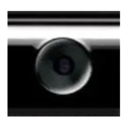

# Kinect Remold documentation

### Runtime, hardware, Studio and developer reference

**Kinect 1414 + 1473 + 1517 · Kinect v2 / Xbox One · Windows + Linux · Native runtime · SynKinect Studio**

[Quick start](QUICKSTART.md) · [Installation](INSTALLATION.md) · [Architecture](ARCHITECTURE.md) · [Build](BUILD-DRIVERS.md)

  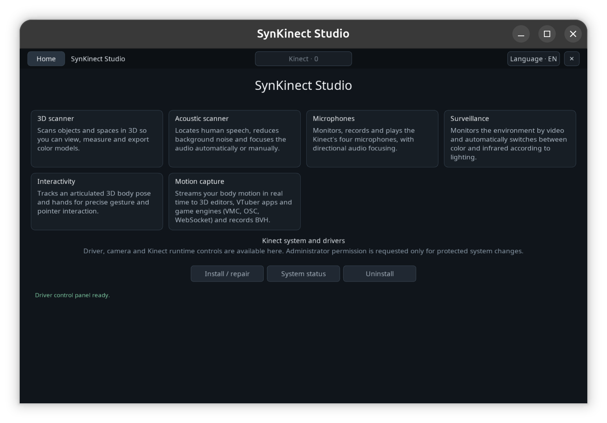

This directory is the engineering and user documentation for Kinect Remold. Start with the shortest path that matches what you are doing, then move into platform or subsystem references only when you need implementation detail.

## Start here

| Goal | Document |
|---|---|
| Build and run quickly | [Quick start](QUICKSTART.md) |
| Install generated runtime packages | [Installation](INSTALLATION.md) |
| Understand ownership, data flow and process boundaries | [Architecture](ARCHITECTURE.md) |
| Talk to a driver endpoint (control, ScannerPort, audio, audio control, SDK `CONTROL`) | [Driver wire-protocol reference](ARCHITECTURE.md#driver-wire-protocol-reference) |
| Build drivers and Studio from source | [Build](BUILD-DRIVERS.md) |
| Compare Kinect models and supported capabilities | [Compatibility matrix](KINECT-COMPATIBILITY-MATRIX.md) |
| Understand the common cross-model user contract | [Unified device contract](UNIFIED-DEVICE-CONTRACT.md) |
| Check what is implemented versus what still needs physical validation | [Functionality status](FUNCTIONALITY-STATUS.md) |

## Sensor and Studio

- [Studio module behavior](STUDIO-MODULE-BEHAVIOR.md) — final runtime behavior of Scanner, Acoustic Scanner, Microphones, Surveillance, Interactivity, Motion Capture, calibration, external modules and resource ownership.
- [Studio UI language](STUDIO-UI-STYLE.md) — shared capitalization, state vocabulary, button behavior, native dialogs and frontend consistency rules.
- [Motion / Smart Tilt](MOTION.md) — accelerometer, tilt lifecycle, per-frame motion samples and automatic framing behavior.
- [Sensor calibration](SENSOR-CALIBRATION.md) — flat-wall depth calibration, distance-aware correction model, tape reference, validation and benchmark.
- [Scanner 3D viewport](SCANNER-3D-VIEWPORT.md) — shared Turntable/Kinect fusion workflow, tracking policies, trajectory, navigation, partial-mesh workflow and coordinate integrity.
- [SynSkeleton 3D architecture](SKELETON-3D-ARCHITECTURE.md) — SynSkeleton.onnx model contract, calibrated 3D mapping, body-tracking block, hands/fingers and no-fallback behavior.
- [Motion capture](MOTION-CAPTURE.md) — real-time VMC / OSC / JSON / WebSocket body streaming to VSeeFace, Unity, Blender and Unreal, humanoid retargeting and BVH recording.
- [Module layout](MODULE-LAYOUT.md) — frontend/backend rule, Studio source files, module data and driver-module directories.
- [Interactivity controls](INTERACTIVITY-CONTROLS.md) — hand interaction zones, push-to-click, two-hand gestures and the air keyboard.
- [Hands and fingers](HANDS-AND-FINGERS.md) — body-level hands and near-field finger refinement (Portuguese).
- [Kinect 1414 transport notes](DRIVER-1414-AUDIO-CONTROL.md) — 1414 camera, motor/control and microphone paths.

## Windows runtime

- [Windows architecture](windows/ARCHITECTURE.md)
- [Protocol reference](windows/PROTOCOL.md)
- [UAC audio runtime](windows/UAC-AUDIO-RUNTIME.md)
- [Microphone endpoint](windows/WINDOWS-MICROPHONE-ENDPOINT.md)
- [Raw sensor lifecycle](windows/RAW-SENSOR-LIFECYCLE.md)
- [Acoustic Scanner](windows/ACOUSTIC-ENVIRONMENT-SCAN.md) — localization, beamforming, noise suppression and output-only voice enhancement
- [IP / MJPEG runtime](windows/IP-CAMERA-RUNTIME.md)

## Linux runtime

- [Driver/runtime](linux/RUNTIME.md)
- [Direct libusb backend](linux/USB-BACKEND.md)
- [IP camera runtime](linux/IP-CAMERA-RUNTIME.md)

## Component READMEs

- Project: [overview](../README.md) · [third-party notices](../THIRD-PARTY-NOTICES.md) · [build/runtime config](../config/README.md) · [build scripts](../scripts/README.md)
- Applications: [applications](../applications/README.md) · [SynKinect Studio](../applications/processing/SynKinectStudio/README.md) · [Studio data](../applications/processing/SynKinectStudio/data/README.md) · [Module SDK](../applications/studio-module-sdk/README.md) · [Python plugin bridge](../applications/studio-module-sdk/PYTHON-PLUGIN-BRIDGE.md) · [runtime templates](../applications/runtime-templates/README.md)
- Drivers: [driver modules](../drivers/README.md) · [module tree](../drivers/modules/README.md) · [Kinect One](../drivers/modules/kinect-one-remold/README.md) · Xbox 360 [Windows](../drivers/modules/kinect-xbox-360-remold/windows/README.md) ([source](../drivers/modules/kinect-xbox-360-remold/windows/source/README.md), [firmware](../drivers/modules/kinect-xbox-360-remold/windows/source/components/device/firmware/README.md), [notices](../drivers/modules/kinect-xbox-360-remold/windows/source/THIRD-PARTY-NOTICES.md)) and [Linux](../drivers/modules/kinect-xbox-360-remold/linux/README.md) ([source](../drivers/modules/kinect-xbox-360-remold/linux/source/README.md), [firmware](../drivers/modules/kinect-xbox-360-remold/linux/source/firmware/README.md))
- Validation scope: see [Functionality status](FUNCTIONALITY-STATUS.md). The source distribution does not include a `tools` or `tests` directory.

## Supported Kinect generations

<table>
<tr>
<td align="center">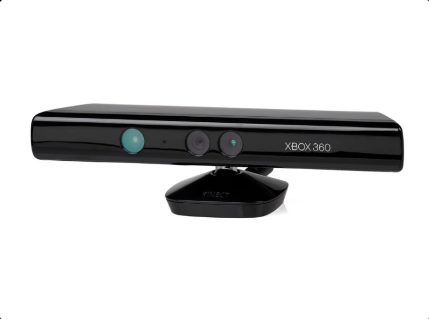 <strong>Kinect first-generation Remold</strong> Models 1414 + 1473 + 1517</td>
<td align="center">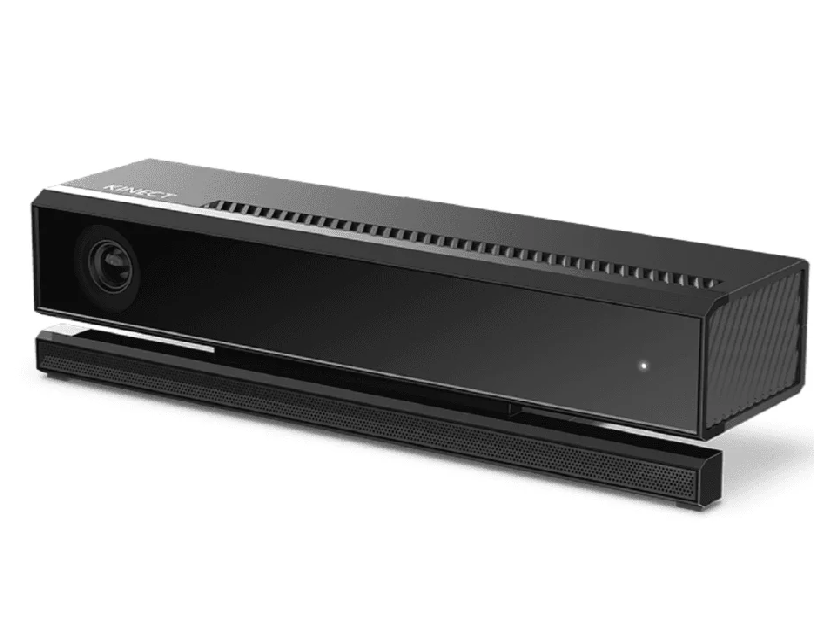 <strong>Kinect Remold — Xbox One</strong> Separate generation module</td>
</tr>
</table>

The first-generation Remold module covers 1414, 1473 and Kinect for Windows 1517 with RGB, IR, depth, four-channel microphone capture, tilt, LED, accelerometer and multi-device routing. Kinect Remold — Xbox One is isolated in its own driver module and implements the current Remold v2 RGB/depth/IR sensor-imaging path for Kinect v2 / Kinect for Xbox One; it does not currently advertise Remold audio, v1 motor/LED controls or an operating-system virtual camera.

The first-generation models deliberately share one user contract: when healthy, 1414, 1473 and 1517 expose the same Studio modules and the same control/audio semantics even though their native USB topology differs. Kinect v2 joins the same capability-driven workflow for the imaging features it implements. See [Unified Kinect device contract](UNIFIED-DEVICE-CONTRACT.md).

## Installation/status appearance

<table>
<tr>
<td align="center"><strong>Windows</strong> Driver setup and status are available in the Studio control panel.</td>
<td align="center">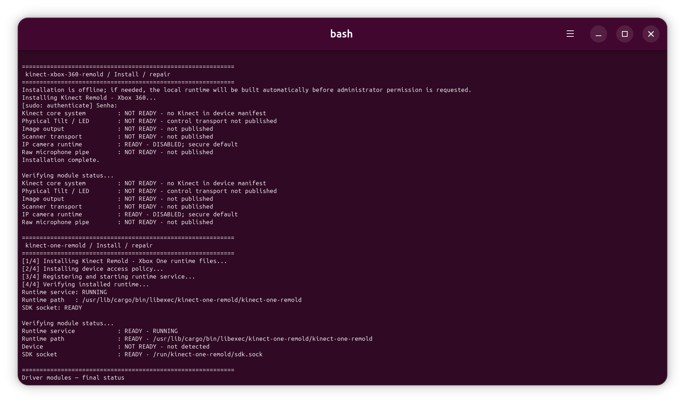 <strong>Linux</strong></td>
</tr>
</table>

The console layout is intentionally parallel across platforms: action header, compact operation output, capability status, and one final module summary. Platform-specific driver details remain in logs unless they are needed to diagnose a failure.

## SynKinect Studio

The Studio uses one shared shell for device selection, language, responsive panels and module navigation. Home exposes the six built-in modules (3D Scanner, Acoustic Scanner, Microphones, Surveillance, Interactivity and Motion Capture) as capability cards and keeps driver maintenance in a dedicated **Kinect system and drivers** area with **Install / Repair**, **System status** and **Uninstall** actions. Each module owns its specialized visualization while reusing the same status, action and control language across Windows and Linux.

<table>
<tr>
<td align="center">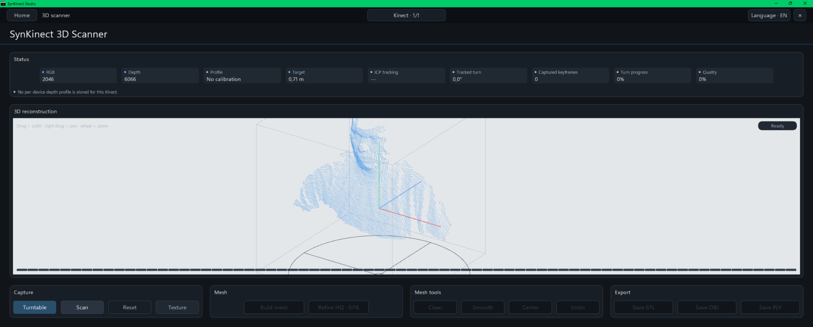 <strong>3D Scanner</strong> Turntable and Kinect Fusion metric RGB-D reconstruction, mesh generation and export.</td>
<td align="center">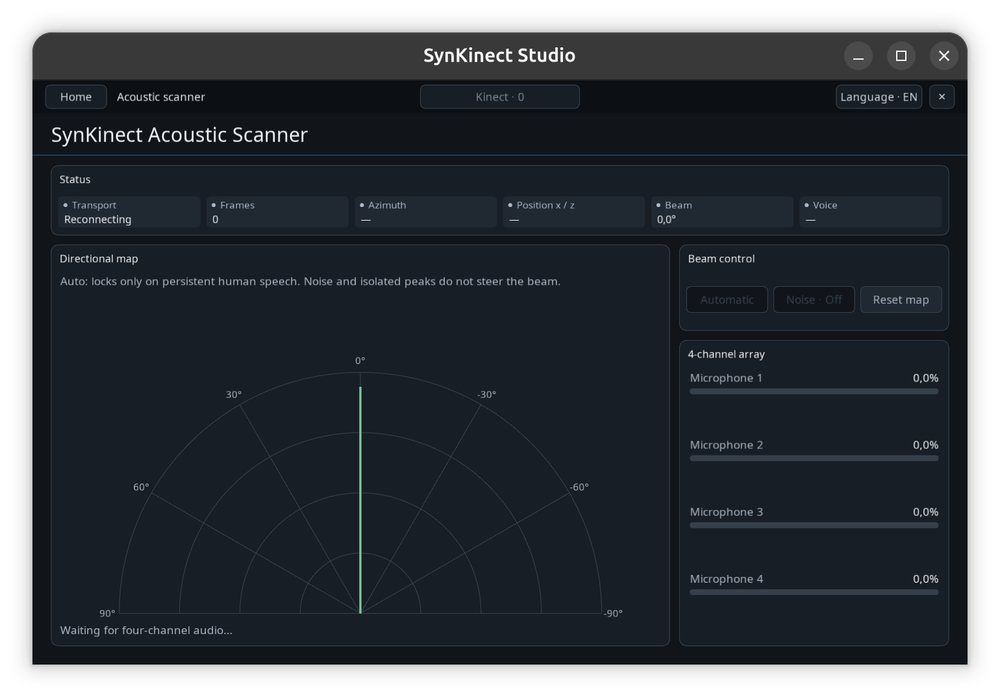 <strong>Acoustic Scanner</strong> Four-channel localization, voice activity and beam control.</td>
</tr>
<tr>
<td align="center">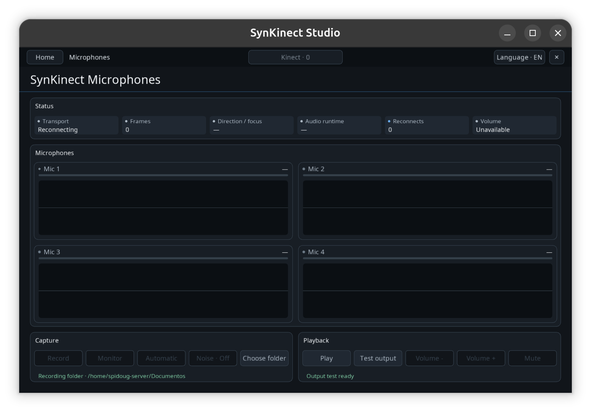 <strong>Microphones</strong> Per-channel monitoring, recording and playback controls.</td>
<td align="center">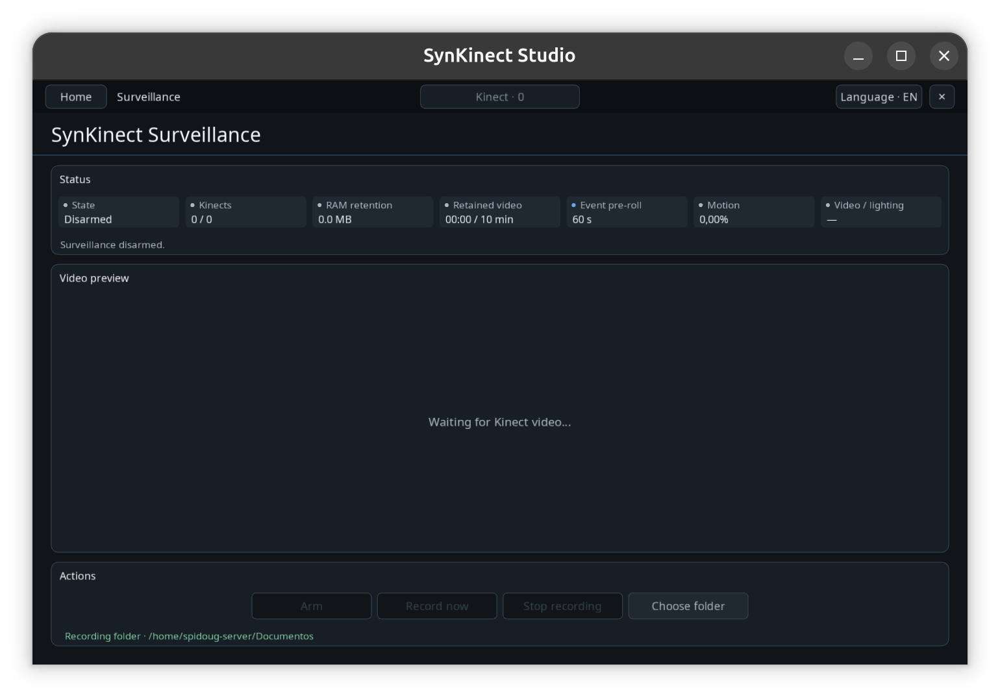 <strong>Surveillance</strong> Multi-Kinect RGB/IR monitoring and event recording.</td>
</tr>
<tr>
<td colspan="2" align="center">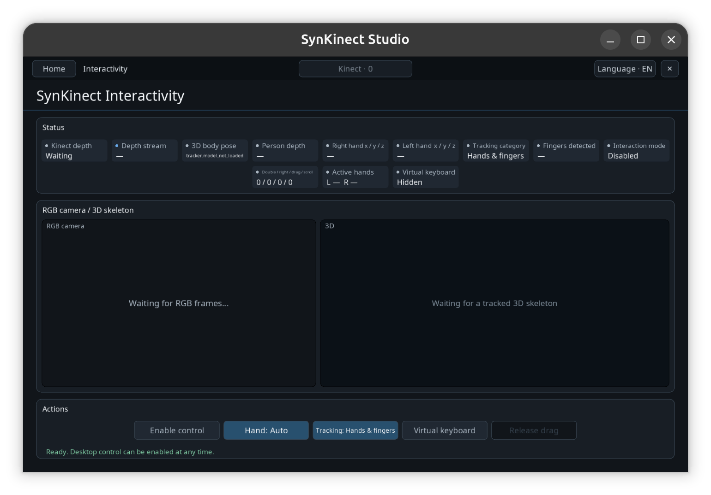 <strong>Interactivity</strong> Articulated body tracking, hand interaction zones, two-hand gestures, air keyboard and near-field fingers.</td>
</tr>
<tr><td colspan="2" align="center">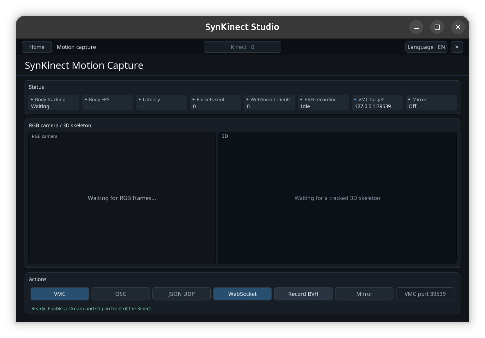 <strong>Motion capture</strong> Live body tracking, streaming and BVH recording.</td></tr>
</table>

Motion Capture has no screenshot yet; it reuses the Interactivity body view with a status panel for the enabled streams. See [Motion capture](MOTION-CAPTURE.md).

## Current high-quality pipelines

- [SynSkeleton 3D Architecture](SKELETON-3D-ARCHITECTURE.md) — SynSkeleton.onnx model-driven tracking, calibrated body/hands/fingers and runtime integration.
- [Scanner 3D Viewport](SCANNER-3D-VIEWPORT.md) — Turntable and moving-Kinect fusion, poor-frame rejection, trajectory-aware capture, quality-weighted TSDF/HQ fusion and multi-view reconstruction.
- [Sensor calibration](SENSOR-CALIBRATION.md) — distance-aware depth correction with optional absolute scale.
- [Acoustic Scanner](windows/ACOUSTIC-ENVIRONMENT-SCAN.md) — four-channel localization, adaptive spectral noise suppression and output-only voice clarity/loudness enhancement.
- [Motion capture](MOTION-CAPTURE.md) — VMC / OSC / JSON / WebSocket streaming and BVH recording.

## Interface screenshots

The screenshots in `images/` show the current Studio interface as captured on Windows and Linux. Device availability, status indicators and paths reflect the capture environment, not guaranteed operating conditions. The 3D scanner image shows a live point-cloud viewport; it does not demonstrate a completed Turntable or Fusion reconstruction. The Linux terminal image documents an installation status without a connected sensor.
